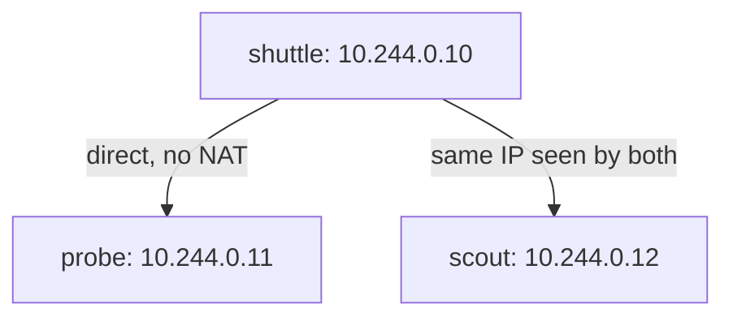

# Pod Addresses And The Network Model

Before a cluster can run an application made of several processes, those processes must be able to find each other on the network. Kubernetes solves this by giving every Pod its own IP address. This part explains what that address is, who can use it, what the three rules of the network model say, and why you must never treat a Pod address as permanent.

## One Pod, one IP address

A Pod is the smallest unit that Kubernetes schedules. It holds one or more containers. When the kubelet (the agent on each node) starts a Pod, the container runtime first creates a network namespace for it. A network namespace is a separate copy of the Linux network stack with its own interfaces, routes and ports. The network plugin then attaches that namespace to the cluster network and gives it one IP address.

All containers in the Pod run inside that one network namespace. They share the same IP address and the same port space. Two containers in one Pod can therefore talk to each other on `localhost`, and they cannot both listen on the same port.

The Pod address is not the node address. A node has its own IP address, and each Pod on the node has a different one. The address range for Pods is separate from the range for nodes and from the range for Services.

## The three rules of the network model

Kubernetes does not describe how the network is built. It describes what the network must allow. The network model has three rules:

- A Pod can send traffic to any other Pod in the cluster without network address translation (NAT).
- A node can send traffic to any Pod on that node without NAT.
- The address a Pod sees for itself is the same address that other Pods see for it.

The result is that an application can put its own IP address in a message, and the receiver can use that address to answer. Applications written for ordinary hosts work without changes. Someone still has to build a network that satisfies these rules, and that component is the network plugin.



The diagram shows one Pod sending traffic straight to the address of another Pod. The addresses are examples; your cluster chooses its own.

## Which component does what

Several components touch a Pod address, and they have different jobs. The scheduler chooses the node for the Pod and does not handle traffic. The kubelet asks the container runtime to create the Pod sandbox, which is the network namespace and the container that keeps it alive. The runtime then calls the network plugin, which allocates the IP address and connects the namespace to the network. The kubelet reports the resulting address in the Pod status, and that is the value `kubectl` prints.

Because the address lives in the Pod status, you can always ask the API server for it. The address is also stored in an EndpointSlice when a Service selects the Pod, which matters when you debug Service traffic.

## Reading Pod addresses

Pod addresses are visible in the Pod status. The `-o wide` output adds the Pod IP and the node name to the normal list.

<!-- astrona:playground:renew -->

```sh
kubectl get pods -A -o wide
```

Look at the `IP` column for the four example Pods. The three Pods in `starfleet` and the Pod in `outpost` all have different addresses, and the addresses are in a different range from the node address that `kubectl get nodes -o wide` shows. Namespaces do not change this: a Pod in `outpost` has an address in the same cluster-wide range as a Pod in `starfleet`.

Now store the address of the `probe` Pod and send a request to it from the `shuttle` Pod. The `probe` application listens on container port 8080.

```sh
PROBE_IP=$(kubectl -n starfleet get pod -l app=probe -o jsonpath='{.items[0].status.podIP}')
echo "$PROBE_IP"
kubectl -n starfleet exec deploy/shuttle -- curl -s --max-time 5 "http://$PROBE_IP:8080/get"
```

The request should return a JSON document that go-httpbin builds from the request. The Pod IP works directly, with no Service involved, because the network model allows Pod-to-Pod traffic. The same request sent from the `drifter` Pod in `outpost` also works, because a namespace is not a network boundary.

## Containers in one Pod share the address

A sidecar container, such as a log shipper or a proxy, depends on this sharing. It can reach the main container on `localhost` without any Service or DNS name.

Ask a Pod for its own address from inside. The `hostname -i` command prints the address that the Pod's network namespace uses.

```sh
kubectl -n starfleet exec deploy/shuttle -- hostname -i
kubectl -n starfleet get pod -l app=shuttle -o jsonpath='{.items[0].status.podIP}'
```

The two commands should print the same address. This confirms the third rule: the address a Pod sees for itself equals the address other Pods use for it.

## Pod addresses change

A Pod is replaced, not repaired. When a Pod is deleted or its node fails, the controller creates a new Pod, and the network plugin allocates a new address. You can see this directly.

```sh
kubectl -n starfleet delete pod -l app=probe
kubectl -n starfleet wait --for=condition=Ready pod -l app=probe --timeout=90s
kubectl -n starfleet get pod -l app=probe -o wide
```

The new Pod has a different name and, in most clusters, a different IP address. Any client that stored the old address now sends traffic to an address that nobody uses. The fix is not to track addresses but to use a stable name, which later parts of this module cover.

## What you now know

Each Pod has one IP address, its containers share it, and Pod-to-Pod traffic needs no address translation. The address lasts only as long as the Pod. The open question is which component makes these addresses reachable between nodes.

## Common pitfalls

> [!WARNING]
> Do not put a Pod IP address in a configuration file or an environment variable; it disappears with the Pod. Do not assume a namespace blocks traffic: without a NetworkPolicy, Pods in different namespaces reach each other freely. Do not confuse the Pod address range with the node and Service address ranges.
