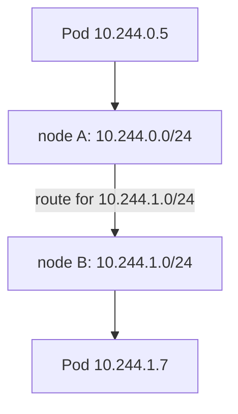

# The Network Plugin And Cross-Node Traffic

The network model says that every Pod can reach every other Pod. Kubernetes itself does not implement this. A separate component, the network plugin, builds the network that makes the rule true. This part explains what the plugin does, what the Container Network Interface (CNI) is, how each node receives its own range of Pod addresses, and how a packet travels between Pods on different nodes.

## Kubernetes defines the rules, a plugin builds the network

The kubelet does not configure network interfaces by itself. It asks the container runtime to create the Pod sandbox, and the runtime calls a CNI plugin. The Container Network Interface is a specification and a set of executables: the runtime runs the plugin with an `ADD` command when a Pod starts and a `DEL` command when it stops. The plugin receives the network namespace of the Pod and a JSON configuration, and it returns the IP address it assigned.

Different plugins build the network in different ways. Calico, Cilium, Flannel and the default plugin in `kind` (kindnet) are examples. They make the same promise to the Pod, which is a reachable IP address, but they differ in speed, features and extra capabilities. Some enforce NetworkPolicy, some replace `kube-proxy`, and some add encryption. A plugin that supports CNI does not necessarily support all of these.

Two settings tell you where the work happens. The CNI configuration files live in `/etc/cni/net.d` on each node, and the plugin binaries live in `/opt/cni/bin`. Most plugins also run an agent as a DaemonSet in `kube-system`, one Pod per node.

## What a CNI call does

When a Pod starts, the runtime creates the network namespace first and the containers second. It then runs the plugin with the `ADD` command. The plugin creates a virtual Ethernet (veth) pair, which works like a cable with two ends. It places one end inside the Pod namespace, usually named `eth0`, and the other end on the node. It then assigns an IP address from the node block, sets the default route inside the Pod, and writes the routes or rules on the node.

When the Pod is deleted, the runtime calls `DEL`, and the plugin releases the address so that another Pod can use it later. This is why an address can appear again on a different Pod after some time. It also explains why a Pod that starts before the plugin is ready stays in `ContainerCreating`: the runtime cannot finish the sandbox until the plugin answers.

## Each node owns a range of Pod addresses

The cluster has one large Pod address range. The control plane splits it so that each node receives a smaller block, called the Pod CIDR (Classless Inter-Domain Routing block). The plugin allocates addresses for Pods on that node from the node's block. Because the blocks do not overlap, no two Pods get the same address.

This split is also what makes routing simple. To send traffic to the address `10.244.1.7`, the network only has to know which node owns the block that contains it.



The diagram shows a Pod on node A reaching a Pod on node B because each node owns one block. The numbers are examples.

## Reading the plugin and the ranges

Start with the node address and the block assigned to the node.

<!-- astrona:playground:renew -->

```sh
kubectl get nodes -o wide
kubectl get nodes -o jsonpath='{range .items[*]}{.metadata.name}{"  "}{.spec.podCIDR}{"\n"}{end}'
```

The first command shows the node internal IP. The second prints each node name with its `podCIDR`. Compare the `podCIDR` with the Pod IP addresses you saw earlier: every Pod address on the node falls inside that block. Some clusters assign Pod ranges in other ways, in which case the field can be empty; in the playground it is set.

Now look for the network plugin. Plugins that run an agent show up as a DaemonSet in the `kube-system` namespace.

```sh
kubectl get daemonset -n kube-system
kubectl get pods -n kube-system -o wide
```

Find the DaemonSet whose name contains `kindnet`. That DaemonSet is the plugin's per-node agent. The `kube-proxy` DaemonSet is a different component, and it handles Service forwarding; do not mix the two up. The Pods named `coredns` provide cluster DNS, which is a third, separate component.

## How a packet crosses nodes

When `shuttle` on node A sends a packet to `probe` on node B, the packet leaves the Pod network namespace through a virtual Ethernet pair and enters the node network stack. The node looks up its route for the destination Pod address. Two designs exist:

- **Routing:** each node has a route that sends the destination block to the node that owns it. The original packet travels as it is.
- **Encapsulation:** the plugin wraps the original packet inside another packet addressed to node B, for example with VXLAN (Virtual Extensible LAN). Node B removes the outer packet and delivers the original to `probe`.

Encapsulation works over networks that do not know the Pod blocks, at the cost of some overhead. Routing is faster but needs the underlying network to accept the routes. In both cases the Pod sees no change, which is why the network model can promise "no NAT".

## When something breaks

Connectivity between Pods can fail at several layers, and the evidence is different at each one. If a Pod has no IP address, the plugin failed to run for that Pod; the Pod stays in `ContainerCreating` and its events mention the sandbox or the network. If Pods on the same node talk but Pods on different nodes do not, suspect the node-to-node path: routes, firewall rules or the encapsulation port. If a connection is refused while the address answers, the network works and the problem is the application's listener.

You can check the first case with one command. A Pod stuck before it gets an address shows the reason in its events.

```sh
kubectl describe pod -n starfleet -l app=shuttle
```

Read the `Events` section at the bottom. On a healthy Pod you see the scheduling, image and start events and no network errors.

## Why the plugin choice matters

The CNI interface only covers attaching a Pod and releasing it. It says nothing about policy, encryption or observability. Those features come from the plugin itself and from agents that it runs on each node. When you compare plugins, ask three questions: how does it move packets between nodes, does it enforce NetworkPolicy, and does it replace the Service forwarding that `kube-proxy` normally does.

Replacing the plugin on a running cluster is a disruptive change, because every Pod address comes from it. Teams choose the plugin when they build the cluster and keep it for the life of the cluster.

## What you now know

The network plugin allocates Pod addresses from a per-node block, connects each Pod namespace to the node and makes the addresses reachable across nodes. CNI is the interface that lets the container runtime call the plugin. Some plugins add extra features, so the plugin you run decides what you can rely on. A stable way to find Pods, which does not depend on addresses, is still missing.

## Common pitfalls

> [!WARNING]
> CNI support alone does not mean NetworkPolicy support; check what your plugin enforces. `kube-proxy` and CoreDNS are not the network plugin. A Pod without an IP address points at the plugin, while a refused connection points at the application.
