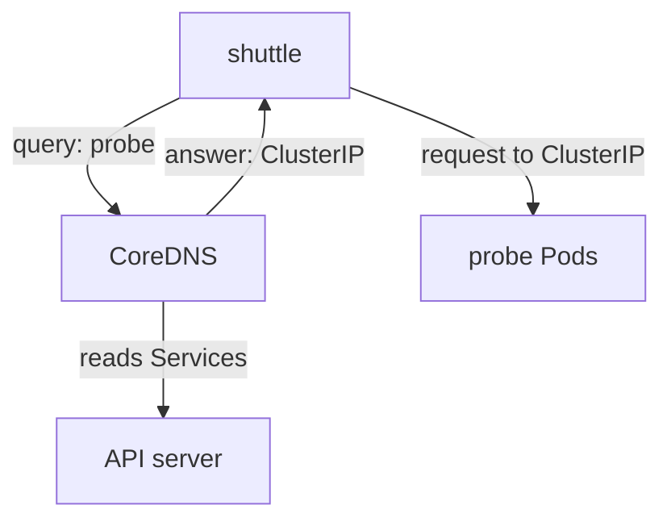

# DNS And Service Discovery In Practice

A client that needs the `probe` application should not store the address of one `probe` Pod, because that address changes. Kubernetes gives each Service a stable name instead, and a DNS (Domain Name System) server inside the cluster turns that name into an address. This part shows what the Pod resolver is configured with, how the three forms of a Service name resolve, what a headless Service answers, and how to tell a name problem from a connection problem.

## How a Pod resolves a name

The cluster runs CoreDNS, a DNS server, as a Deployment in the `kube-system` namespace. A Service called `kube-dns` fronts it, and the Service address is the cluster DNS address. For every Pod, the kubelet writes `/etc/resolv.conf` with three kinds of entries:

- `nameserver`: the address of the `kube-dns` Service.
- `search`: a list of domain suffixes, in this order: `<namespace>.svc.<cluster-domain>`, `svc.<cluster-domain>`, and `<cluster-domain>`. The default cluster domain is `cluster.local`.
- `options ndots:5`: a name with fewer than five dots is first tried with each search suffix before it is tried as written.

The search list is what makes short names work. When `shuttle` asks for `probe`, the resolver tries `probe.starfleet.svc.cluster.local` first, finds the Service, and stops. The same short name from `drifter` in `outpost` first becomes `probe.outpost.svc.cluster.local`, which does not exist, so it fails.

## The three forms of a Service name

A Service has one fully qualified domain name (FQDN) and two shorter forms that depend on where the client runs:

- `probe`: works only from the same namespace.
- `probe.starfleet`: works from any namespace.
- `probe.starfleet.svc.cluster.local`: the FQDN, which works everywhere that uses the default cluster domain.

CoreDNS answers a Service name with the Service address (the ClusterIP), not with a Pod address. The kubernetes plugin in CoreDNS reads Services and EndpointSlices from the API server and builds the answers from them.



The diagram shows two separate steps: name resolution through CoreDNS, then the request to the address that the answer returned.

## Look at the resolver

Start with the resolver file of the `shuttle` Pod.

<!-- astrona:playground:renew -->

```sh
kubectl -n starfleet exec deploy/shuttle -- cat /etc/resolv.conf
```

Read the three kinds of entries. The first search entry names the `starfleet` namespace. The `nameserver` address is the ClusterIP of the `kube-dns` Service, which you can confirm with `kubectl -n kube-system get svc kube-dns`. Check the same file in `drifter` and note that its first search entry names `outpost`.

## Resolve all three forms

Send a request with each form of the name from `shuttle`. Port 80 is the Service port.

```sh
kubectl -n starfleet exec deploy/shuttle -- curl -s --max-time 5 -o /dev/null -w '%{http_code}\n' http://probe/get
kubectl -n starfleet exec deploy/shuttle -- curl -s --max-time 5 -o /dev/null -w '%{http_code}\n' http://probe.starfleet/get
kubectl -n starfleet exec deploy/shuttle -- curl -s --max-time 5 -o /dev/null -w '%{http_code}\n' http://probe.starfleet.svc.cluster.local/get
```

Each command should print `200`. Now send the short name from `drifter` in the other namespace:

```sh
kubectl -n outpost exec deploy/drifter -- curl -s --max-time 5 -o /dev/null -w '%{http_code}\n' http://probe/get
kubectl -n outpost exec deploy/drifter -- curl -s --max-time 5 -o /dev/null -w '%{http_code}\n' http://probe.starfleet/get
```

The first command should fail. `curl` prints `000` for the status code and exits with a name resolution error, because `probe.outpost.svc.cluster.local` does not exist. The second command should print `200`.

## A headless Service answers with Pod addresses

A Service with `clusterIP: None` is headless. It has no virtual address, so CoreDNS answers a query for its name with the addresses of the ready Pods that it selects. Clients that need to reach each Pod separately, such as members of a database cluster, use this form. Save this as `service-probe-pods.yaml`:

```yaml
apiVersion: v1
kind: Service
metadata:
  name: probe-pods
  namespace: starfleet
spec:
  clusterIP: None
  selector:
    app: probe
  ports:
    - name: http
      port: 8080
      targetPort: http
```

Apply it:

```sh
kubectl apply -f service-probe-pods.yaml
```

Then request the name from `shuttle`, using the container port, because a headless Service has no virtual address that maps port 80 to port 8080:

```sh
kubectl -n starfleet exec deploy/shuttle -- curl -s --max-time 5 -o /dev/null -w '%{http_code}\n' http://probe-pods:8080/get
```

The command should print `200`. The name resolved to the Pod address, and the request went straight to the Pod.

## Name problems and connection problems

The two failures look alike in an application log but have different causes. A name that does not resolve shows an error such as `Could not resolve host`, and no request ever leaves the Pod. A name that resolves to an address that does not answer shows a timeout or `Connection refused`. A fast check is to run the request against the FQDN, and then against the Pod IP. If the FQDN fails and the Pod IP works, the problem is in DNS or in the Service. If both fail, look at the network or the application.

## What you now know

CoreDNS resolves Service names to Service addresses, the search list makes short names depend on the client namespace, and a headless Service resolves to Pod addresses. Resolving a name and reaching the address are two separate steps with separate evidence.

## Common pitfalls

> [!WARNING]
> A short name works only inside its own namespace. A headless Service needs the container port, not the Service port. A resolved name does not prove that the application answers, and a failed request does not prove that DNS is broken.
