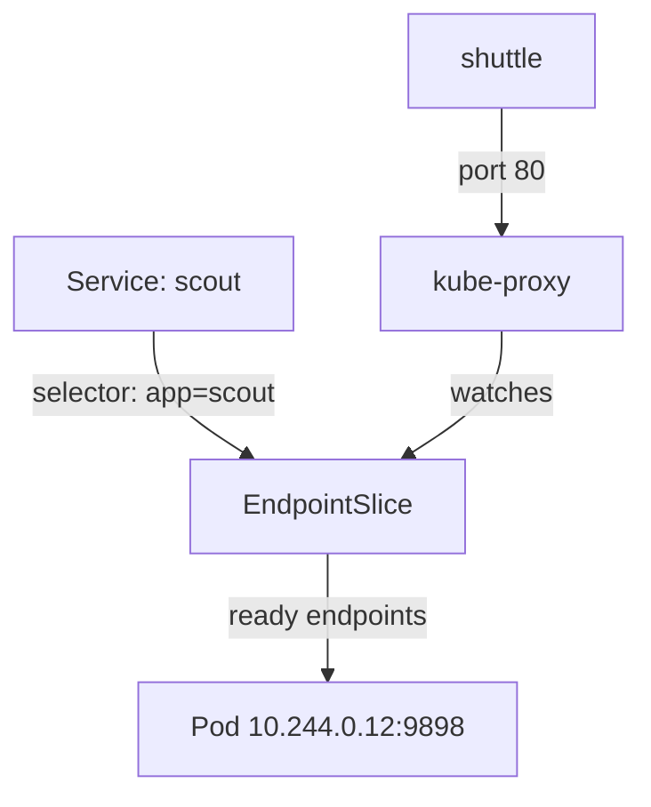

# Selectors, Ports And Backends

A client needs one address that keeps working while Pods are created and deleted. A Service provides it. This part explains how a Service chooses its Pods, which of its port fields does what, and where the list of ready Pod addresses lives. Knowing these three things lets you explain nearly every "the Service does not answer" problem.

## A Service selects Pods with labels

A Service has a `selector`, which is a set of label key and value pairs. Every Pod in the same namespace that carries all of those labels is a candidate backend. The Service does not own the Pods and does not start them. It only matches them by label.

The match is continuous. When a Pod with a matching label starts, it becomes a candidate. When a label changes or a Pod is deleted, it stops being one. A Service whose selector matches no Pod is valid, and it simply has no backends.

The `scout` Service in the playground uses `app: scout` as its selector. The Pods of the `scout` Deployment carry `app: scout` in their template, so they match.

## The three port fields

A Service port entry has up to three numbers, and they are easy to confuse:

- `port`: the port on the Service address that clients connect to.
- `targetPort`: the port on the Pod that receives the traffic. It can be a number or the name of a container port.
- `nodePort`: the port opened on every node, only for the NodePort and LoadBalancer types.

For `scout`, clients use port 80 and the Pod listens on 9898. The Service maps one to the other. Naming the container port (`http`) and using that name as `targetPort` keeps the Service correct if the container port number changes.

## EndpointSlices hold the ready addresses

Which Pods are ready right now? The EndpointSlice controller in the control plane answers this. It watches the Service and the matching Pods, and it writes EndpointSlice objects that list the Pod IP addresses, the ports and a `ready` condition for each endpoint. A Pod counts as ready when its readiness probe passes.

`kube-proxy` on each node watches EndpointSlices and programs the node so that a connection to the Service address goes to one of the ready endpoints. The Service address is virtual; no interface owns it. EndpointSlices replaced the older Endpoints objects because a single Endpoints object grew too large for big Services. One Service can have several slices, and each slice holds up to 100 endpoints by default.



The diagram shows the EndpointSlice controller output that `kube-proxy` uses to forward a request from the client to a ready Pod.

## Read a Service and its endpoints

Look at the Service and the slices that belong to it. The label `kubernetes.io/service-name` links a slice to its Service.

<!-- astrona:playground:renew -->

```sh
kubectl -n starfleet describe svc scout
kubectl -n starfleet get endpointslices -l kubernetes.io/service-name=scout
```

The description shows the selector, the Service address, the port mapping and the endpoint address. The slice list shows the same Pod address with the port 9898. Compare the address with `kubectl -n starfleet get pod -l app=scout -o wide`; they should match.

## Change the backends and watch the slice

Scale the application to three replicas, wait for them, and read the slice again.

```sh
kubectl -n starfleet scale deployment scout --replicas=3
kubectl -n starfleet rollout status deployment/scout
kubectl -n starfleet get endpointslices -l kubernetes.io/service-name=scout -o yaml
```

The slice should now list three endpoints, each with `ready: true`. Scaling changed the Pods, and the EndpointSlice controller updated the slice. The Service was not touched.

## A Service without endpoints

Change the label that the Service selects on for one Pod and see what happens. Setting the label to a different value is enough to unmatch a Pod. Replace `<POD>` with one Pod name from `kubectl -n starfleet get pods -l app=scout`:

```sh
kubectl -n starfleet label pod <POD> app=scout-old --overwrite
kubectl -n starfleet get endpointslices -l kubernetes.io/service-name=scout -o yaml
```

Right after the change the slice should list two endpoints, because the relabelled Pod no longer matches the Service. The ReplicaSet also no longer counts that Pod, so it creates a replacement, and the slice lists three endpoints again after the new Pod is ready. The relabelled Pod keeps running but receives no Service traffic. Delete it with `kubectl -n starfleet delete pod <POD>` when you finish.

An empty slice has a recognisable cause. If the Service shows no endpoints, compare its `selector` with the Pod labels, and check that the Pods are ready. A selector typo is the most common reason. A wrong `targetPort` is the second, and it looks different: the slice has endpoints, but requests fail with `Connection refused`.

## Named ports and multiple ports

Port handling is a common source of mistakes, so it helps to know the exact rule.

A Service can expose several ports. When it does, every port entry needs a `name`, so that the control plane and tools can tell the entries apart. The EndpointSlice repeats those names, which lets a client library find the port by name. When `targetPort` is a name, Kubernetes looks it up in each Pod separately. Two Pods behind one Service can therefore use different container port numbers for the same port name, which is useful during a migration.

The `protocol` field defaults to TCP. A Service for a DNS server, for example, needs both a TCP and a UDP entry with the same port number.

## What you now know

A Service selects Pods by label, maps its `port` to the Pod `targetPort`, and relies on EndpointSlices for the list of ready addresses. `kube-proxy` turns that list into forwarding rules on each node. The question left open is who can reach the Service address.

## Common pitfalls

> [!WARNING]
> A Service selects Pods only in its own namespace. A selector that matches nothing creates no error; the Service just has no endpoints. A Pod that fails its readiness probe is removed from the slice, so a Service can have Pods and still have no ready endpoints.
