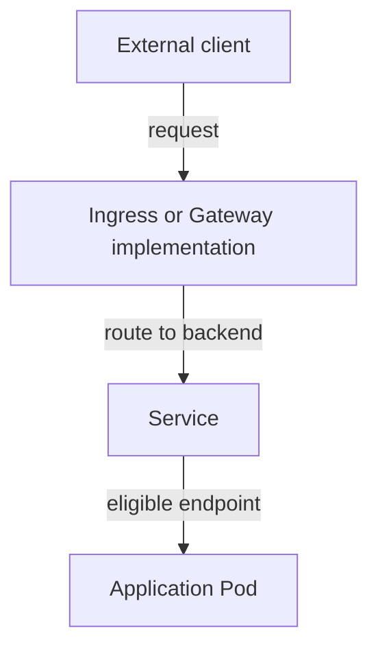

# External Entry And Application Routing

A team wants browsers outside the cluster to reach `probe`. A NodePort Service exposes a port on node addresses through the cluster's Service implementation. An external client still needs network access to those node addresses. Firewall and infrastructure routing rules can prevent access even when the Service object exists.

A LoadBalancer Service requests an external load balancer through an available implementation, often a cloud integration. A local cluster may have no implementation that provides an external address. Creating the resource does not automatically install a cloud load balancer or make one available on every platform.

Ingress describes external web routing rules, commonly based on hostnames and paths, for Hypertext Transfer Protocol (HTTP) traffic. An Ingress controller implements those rules. Creating an Ingress resource without a suitable controller leaves the routing intent without the component needed to serve traffic.

The Gateway API is a set of Kubernetes networking APIs with explicit roles for infrastructure and application routing. A GatewayClass identifies a controller implementation. A Gateway describes listeners, and a route such as HTTPRoute describes how matching requests reach backends. Availability depends on installed resource definitions, a compatible controller and supported features.

The entry implementation interprets routing resources and forwards requests toward the application backend.

Choose an access method from the protocol, platform and operating roles. A stable internal endpoint suggests ClusterIP. Node-level exposure suggests NodePort. An external load balancer requires supporting infrastructure. Shared HTTP routing requires an appropriate Ingress or Gateway implementation rather than only another Pod label.

## Mapping Infrastructure And Application Roles

With NodePort, the external caller connects to a node address and allocated node port. The cluster's forwarding implementation then connects that access path to Service backends. The caller needs a reachable node address and the infrastructure must permit the traffic. A private node address behind a firewall is not made public by the Kubernetes resource alone.

With LoadBalancer, a supporting integration provisions or configures an external access point. Its health behavior and forwarding arrangement can depend on the implementation and platform. Pending external-address allocation can therefore mean infrastructure integration is missing or still progressing, rather than that the application image failed.

An Ingress controller adds HTTP routing based on declared rules. A matching host and path can select a backend, and transport security can be configured through the implementation's supported mechanisms. The route declaration and the serving controller are separate resources and responsibilities. A correct rule without a reachable controller does not provide an endpoint.

## Gateway API Role Separation

GatewayClass identifies which controller handles a class of gateways. Infrastructure operators can manage gateway listeners and allowed route attachment. Application owners can manage routes that attach where permitted. This separates a shared entry platform from each application's routing intent, subject to the API's and implementation's supported controls.

A route can be present but not accepted, or accepted but unable to resolve its backend references. Status conditions help distinguish those outcomes. Cross-namespace references can require explicit permission mechanisms, so a route pointing at another namespace is not automatically authorized merely because the object exists.

For a proposed access method, list the client protocol, infrastructure capability, route owner and backend. Internal connectivity, public exposure and application routing are different requirements. The complete solution supplies the implementation and permissions that realize the declared access path, then verifies the request behavior from the intended external caller.

## Common pitfalls

> [!WARNING]
> Routing resources describe intent. External addresses and HTTP routes require a functioning implementation and reachable infrastructure.
