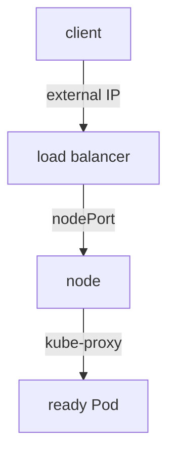

# Service Types And Node Access

A ClusterIP Service answers only inside the cluster. Many applications must also be reachable from a laptop, a load balancer or another network. The Service `type` field decides how far the Service address reaches. This part compares the five forms: ClusterIP, NodePort, LoadBalancer, headless and ExternalName, and states exactly which component does the work for each.

## ClusterIP: inside the cluster

ClusterIP is the default type. The API server allocates a virtual address from the Service address range, and `kube-proxy` makes it work on every node. The address is not assigned to any interface. A connection from a Pod to it is rewritten on the node to the address of one ready Pod. Only clients inside the cluster, and the nodes themselves, can reach it.

## NodePort: a port on every node

A NodePort Service is a ClusterIP Service plus one more entry. The control plane picks a port from a range, by default 30000 to 32767, and `kube-proxy` opens that port on every node. A request to `<node address>:<nodePort>` is forwarded to a ready Pod, even when that Pod runs on a different node. You can choose the port yourself with `nodePort`, as long as it is in the range and unused.

NodePort is a building block. It exposes an application on the node network, and firewalls and node addresses become your concern.

## LoadBalancer: an external address

A LoadBalancer Service builds on NodePort. The Service controller of the cloud provider, through the cloud controller manager, creates an external load balancer and sends traffic to the node ports. When the cloud finishes, the Service status shows the external address. On a cluster without a cloud provider, for example `kind`, nothing creates the load balancer, and the external address stays `<pending>` forever. Projects such as MetalLB add that controller for clusters outside a cloud.



The diagram shows that a LoadBalancer Service reaches a Pod through a node port, so each outer type contains the inner one.

## Headless and ExternalName

A headless Service has `clusterIP: None`. It has no virtual address and `kube-proxy` does nothing for it. DNS answers with the addresses of the ready Pods, so a client can see all of them. StatefulSets use headless Services to give each Pod a stable DNS name.

An ExternalName Service has no selector and no endpoints. CoreDNS answers a query for its name with a CNAME record that points at the value of `externalName`. It is a DNS alias, so it works at the name level only and does not map ports.

## Try the types

<!-- astrona:playground:renew -->

Save this as `service-scout-nodeport.yaml`:

```yaml
apiVersion: v1
kind: Service
metadata:
  name: scout-nodeport
  namespace: starfleet
spec:
  type: NodePort
  selector:
    app: scout
  ports:
    - name: http
      port: 80
      targetPort: http
      nodePort: 30080
```

Apply it:

```sh
kubectl apply -f service-scout-nodeport.yaml
```

Then check the result:

```sh
kubectl -n starfleet get svc scout-nodeport
kubectl -n starfleet exec deploy/shuttle -- curl -s --max-time 5 -o /dev/null -w '%{http_code}\n' http://scout-nodeport/healthz
```

The Service list should show type `NodePort` and the port pair `80:30080/TCP`, and the request through the cluster address should print `200`. A NodePort Service also has a ClusterIP, which is why the second command works.

Now create a LoadBalancer Service. Save this as `service-scout-lb.yaml`:

```yaml
apiVersion: v1
kind: Service
metadata:
  name: scout-lb
  namespace: starfleet
spec:
  type: LoadBalancer
  selector:
    app: scout
  ports:
    - name: http
      port: 80
      targetPort: http
```

Apply it and read the Service:

```sh
kubectl apply -f service-scout-lb.yaml
kubectl -n starfleet get svc scout-lb
```

The `EXTERNAL-IP` column should show `<pending>` and stay that way, because the playground has no load balancer controller. Kubernetes still allocated a node port for the Service, which you can see in the `PORT(S)` column.

## Choosing a type

Use ClusterIP for traffic between workloads. Use NodePort when something outside the cluster can already reach the node addresses and you accept the port range. Use LoadBalancer when the platform provides an external load balancer and you need one address per Service. When many HTTP applications share one entry point, an Ingress or a Gateway is usually a better fit than many LoadBalancer Services, because each LoadBalancer Service may create a separate cloud resource with a cost.

## What you now know

Each Service type includes the one before it: LoadBalancer adds an external address to NodePort, and NodePort adds a node port to ClusterIP. Headless and ExternalName Services work through DNS and not through `kube-proxy`. Whether an external address appears depends on a controller outside the Service itself. Routing by host name and path, which these types do not do, is still open.

## Common pitfalls

> [!WARNING]
> A LoadBalancer Service without a controller stays `<pending>` and is not an error in the Service. A node port outside 30000 to 32767 is rejected. ExternalName does not remap ports and is not a proxy, so the target must listen on the port that the client uses.
