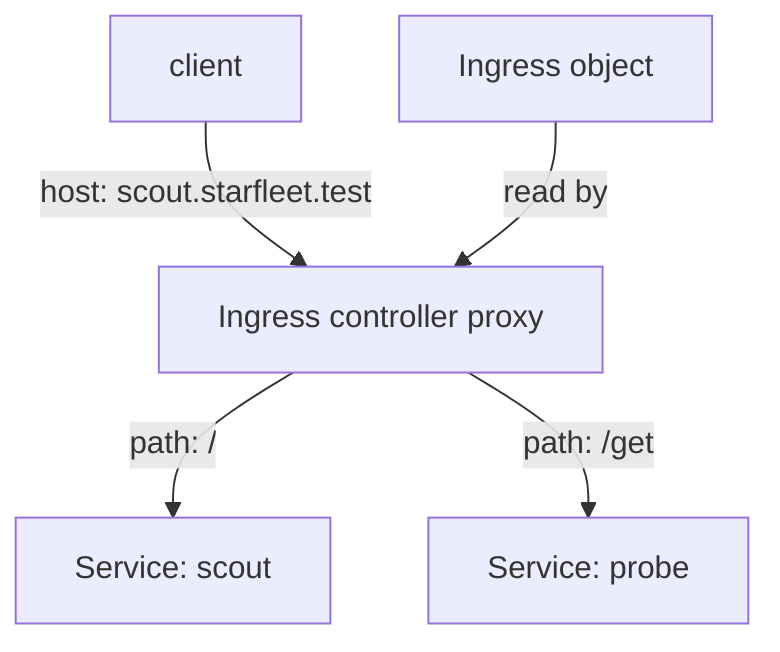

# External Entry And Application Routing

A LoadBalancer Service forwards one external address to one set of Pods. Web applications usually need more: several host names and URL paths share one address, and each one goes to a different Service, often with Transport Layer Security (TLS). Kubernetes describes this routing with an Ingress object or with the Gateway API. This part explains what each object contains, which component acts on it, and why the objects alone do nothing.

## Ingress: rules stored in the API

An Ingress is an API object that holds HTTP routing rules. A rule has an optional host, a path with a path type, and a backend, which names a Service and a port. An Ingress can also list a TLS Secret for a host. The object is only data. The API server validates and stores it, and no traffic changes.

An Ingress controller does the work. It is a program that runs in the cluster, watches Ingress objects, and configures a proxy, such as NGINX or Envoy, to follow the rules. The proxy receives the external request, matches the host and path, and forwards the request to the Pods of the chosen Service. The controller is a separate installation, and the cluster can run several, which is why an Ingress selects one with `ingressClassName`.



The diagram shows one proxy receiving external requests and sending each to a Service, using rules that come from the Ingress object.

## Path types

The `pathType` field decides how a path matches. `Exact` matches the path exactly. `Prefix` matches by path segments, so `/get` matches `/get` and `/get/1`, but not `/getting`. `ImplementationSpecific` leaves the decision to the controller. When several rules match, the longest matching path wins, and an exact match beats a prefix.

## Create an Ingress

The API server accepts Ingress objects even without a controller. Save this as `ingress-starfleet.yaml`:

<!-- astrona:playground:renew -->

```yaml
apiVersion: networking.k8s.io/v1
kind: Ingress
metadata:
  name: starfleet-web
  namespace: starfleet
spec:
  ingressClassName: nginx
  rules:
    - host: scout.starfleet.test
      http:
        paths:
          - path: /
            pathType: Prefix
            backend:
              service:
                name: scout
                port:
                  number: 80
    - host: probe.starfleet.test
      http:
        paths:
          - path: /
            pathType: Prefix
            backend:
              service:
                name: probe
                port:
                  number: 80
```

Apply it:

```sh
kubectl apply -f ingress-starfleet.yaml
```

Then check the result:

```sh
kubectl -n starfleet get ingress starfleet-web
kubectl -n starfleet describe ingress starfleet-web
```

The object should be created. The `ADDRESS` column stays empty, because no controller reads the Ingress and sets its status. The description lists the two hosts and shows each backend with the endpoint addresses of its Service. This shows the split of work: the API stores the rules, and a controller is needed to act on them.

Check which controller classes the cluster knows:

```sh
kubectl get ingressclass
```

A cluster without a controller shows no resources. An Ingress that names a class nobody serves is ignored.

## Gateway API: separate roles

The Gateway API is the newer model for the same problem. It splits the rules into objects that different people own:

- `GatewayClass`: names a controller implementation. The infrastructure provider owns it.
- `Gateway`: asks for a listener, such as port 443 with a certificate. The platform team owns it. A controller turns it into a real load balancer or proxy.
- `HTTPRoute`: holds the routing rules, such as host, path and header matches, and names the Services to forward to. The application team owns it and attaches it to a Gateway with `parentRefs`.

A Gateway lists which namespaces may attach routes to it, so an application team cannot hijack a listener that belongs to another team. HTTPRoute can also split traffic by weight and rewrite headers, which an Ingress cannot do without controller-specific annotations. The Gateway API types are Custom Resource Definitions, so the cluster must install them, and a controller must implement them.

## Ingress or Gateway

An Ingress is simple and widely supported, and it covers HTTP host and path routing. The Gateway API separates roles, supports more protocols and has a standard way to express features that Ingress leaves to annotations. Kubernetes keeps the Ingress API stable but sends new routing features to the Gateway API.

For a request to work, a chain of objects must all be correct: an external address, a controller proxy, a rule that matches the host and path, a Service with endpoints, and a ready Pod. When a request fails, check the chain from the Pod outward.

## What you now know

An Ingress and a Gateway API route are descriptions of routing. A controller reads them and configures a proxy. A Service stays the backend that the route targets. Selecting the right layer for a symptom is the skill that remains.

## Common pitfalls

> [!WARNING]
> An Ingress without an Ingress controller does nothing, and an empty address is the sign. An Ingress is not a Service and does not replace one. Gateway API objects need their Custom Resource Definitions and a controller before any traffic flows.
