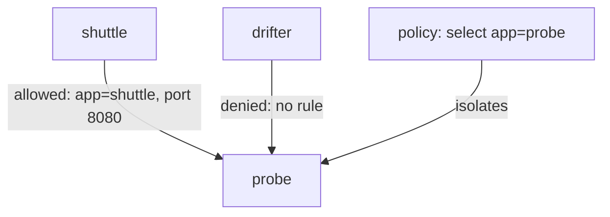

# NetworkPolicy And Allowed Connections

A cluster in its default state has no network boundaries between Pods. A NetworkPolicy adds them. This part explains what a policy selects, what isolation means, and how an ingress rule names the clients that may connect. You will watch a request succeed, apply a policy, and watch the same request fail for one client and keep working for another.

## What a NetworkPolicy is

A NetworkPolicy is a namespaced API object. It has a `podSelector`, which chooses the Pods in its own namespace that the policy applies to, and a `policyTypes` list that names the directions: `Ingress` for incoming traffic and `Egress` for outgoing traffic. It then lists allowed traffic for those directions.

The API server only stores the object. The network plugin enforces it, by programming the node packet filter on each node. If the plugin does not support NetworkPolicy, the object is accepted and has no effect. This is the reason the first check on a "blocked traffic still passes" report is the plugin and not the policy.

## Isolation and the allow list

Pods start non-isolated: all traffic is allowed. A Pod becomes isolated for a direction as soon as any policy selects it and lists that direction in `policyTypes`. From then on, only traffic that some policy allows is permitted in that direction. There are no deny rules. Policies only allow, and they add up: the allowed traffic is the union of every rule from every policy that selects the Pod.

An isolated Pod does not lose the traffic from its own node, such as health checks from the kubelet. Plugins usually allow it.

## Selecting the sources

An ingress rule has a `from` list. Each item selects sources in one of three ways:

- `podSelector`: Pods in the policy namespace that match the labels.
- `namespaceSelector`: all Pods in the namespaces whose labels match. Every namespace has the automatic label `kubernetes.io/metadata.name`, so you can select a namespace by name.
- `ipBlock`: a range of IP addresses, mostly for traffic from outside the cluster.

Items in the `from` list are alternatives. Within one item, a `namespaceSelector` and a `podSelector` together mean AND: Pods that match the second selector in namespaces that match the first. This difference between two list items and one combined item is the most common policy mistake. A `ports` list narrows the rule to given ports and protocols, and it names the port on the destination Pod, not the Service port.



The diagram shows a policy that selects `probe`. It allows the `shuttle` client and denies every other source.

## See the open default

Send a request to the `probe` Pod from both clients, using the Pod address, as policy applies to Pods and not to Service addresses.

<!-- astrona:playground:renew -->

```sh
PROBE_IP=$(kubectl -n starfleet get pod -l app=probe -o jsonpath='{.items[0].status.podIP}')
kubectl -n starfleet exec deploy/shuttle -- curl -s --max-time 5 -o /dev/null -w '%{http_code}\n' "http://$PROBE_IP:8080/get"
kubectl -n outpost exec deploy/drifter -- curl -s --max-time 5 -o /dev/null -w '%{http_code}\n' "http://$PROBE_IP:8080/get"
```

Both commands should print `200`. No policy exists, so nothing limits the traffic.

## Allow only shuttle

Save this as `networkpolicy-probe-from-shuttle.yaml`:

```yaml
apiVersion: networking.k8s.io/v1
kind: NetworkPolicy
metadata:
  name: probe-from-shuttle
  namespace: starfleet
spec:
  podSelector:
    matchLabels:
      app: probe
  policyTypes:
    - Ingress
  ingress:
    - from:
        - podSelector:
            matchLabels:
              app: shuttle
      ports:
        - protocol: TCP
          port: 8080
```

Apply it:

```sh
kubectl apply -f networkpolicy-probe-from-shuttle.yaml
```

Then repeat the two requests from the previous step. The request from `shuttle` should still print `200`. The request from `drifter` should hang until `curl` gives up after five seconds and prints `000`, because the policy isolated `probe` and the rule lists only Pods labelled `app=shuttle` in `starfleet`. A dropped connection times out; it does not return a refusal.

Check the scope of the policy by sending a request from `drifter` to the `scout` Pod. It should still work, because the policy selects only the `probe` Pods.

```sh
kubectl -n starfleet describe networkpolicy probe-from-shuttle
```

The description summarises which Pods are selected and which traffic is allowed.

## Selecting a whole namespace

If `outpost` should also reach `probe`, add a second item to the `from` list that selects the namespace by its name label. Two items in the list mean "this OR that". The namespace item would allow every Pod in `outpost`, not just `drifter`, which is why combining it with a Pod selector in one item is often the safer rule.

## Common pitfalls

> [!WARNING]
> A NetworkPolicy has no effect when the network plugin does not enforce it. A policy applies to Pods, so test with the Pod address when you need to rule out the Service. A blocked connection times out and does not show a refusal. Two items in a `from` list are alternatives, while one item with two selectors is a combination.
