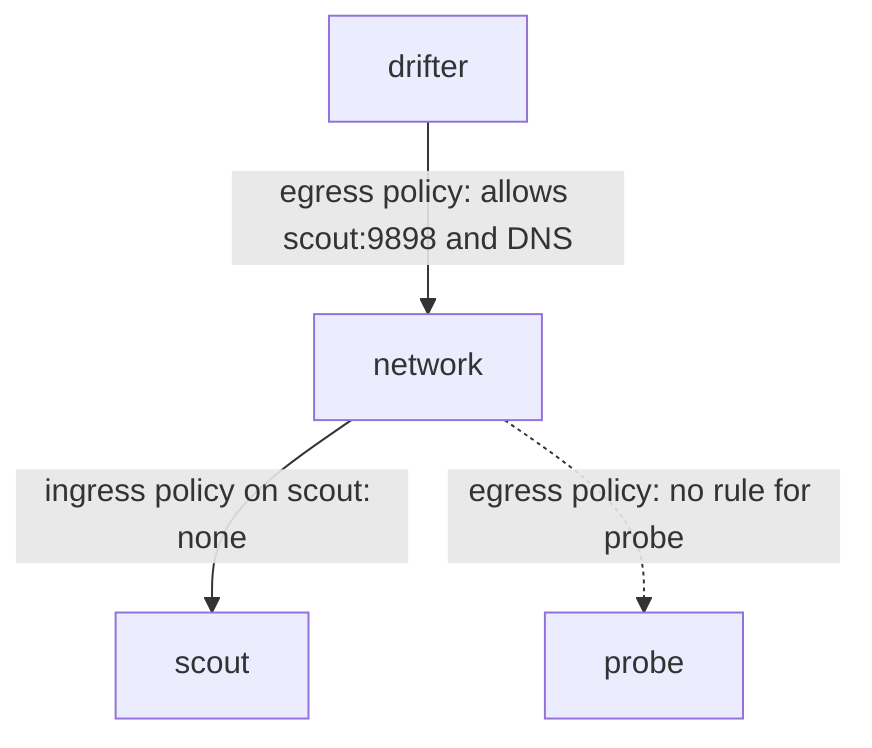

# Egress Rules And Both Directions

An ingress policy protects a Pod from what reaches it. It does not stop a compromised Pod from calling out. Egress policies limit what a Pod may send. This part explains egress rules, the DNS rule that almost every egress policy needs, and the principle that a connection works only when the sender's egress and the receiver's ingress both allow it.

## Egress rules

An egress policy uses the same selectors as an ingress policy, in a `to` list instead of `from`. When a policy selects a Pod and lists `Egress`, the Pod can send only what some policy allows. A default-deny egress policy is therefore a policy with an empty `podSelector` (all Pods in the namespace), `policyTypes: [Egress]` and no `egress` rules.

Egress matching happens on the destination Pod address after Service address translation. A rule must name the Pod and the Pod port, not the Service address and the Service port. If a rule names port 80 because the Service port is 80, but the Pods listen on 9898, the traffic stays blocked.

## DNS is traffic too

A client that calls a Service by name first sends a DNS query to the cluster DNS Pods in `kube-system`. If an egress policy blocks that query, the name never resolves, and the application fails with a name error even though the target is allowed. Almost every egress policy therefore includes a rule for DNS: UDP and TCP port 53 to the CoreDNS Pods.

The DNS Pods carry the label `k8s-app: kube-dns`, and the `kube-system` namespace carries the automatic name label. Selecting both in one item of the `to` list limits the rule to the DNS Pods.

## Both sides must allow

For a connection from Pod A to Pod B, two checks apply. A's egress policies must allow the traffic to B, and B's ingress policies must allow the traffic from A. A Pod that no policy selects for a direction is open in that direction. The connection fails when either check fails.



The diagram shows the connection from `drifter` to `scout` passing because the sender's egress allows it and `scout` has no ingress policy, while the connection to `probe` is stopped by the sender's egress policy.

## Restrict drifter

The `drifter` Pod should reach only the `scout` Pods and DNS. Save this as `networkpolicy-drifter-egress.yaml`:

<!-- astrona:playground:renew -->

```yaml
apiVersion: networking.k8s.io/v1
kind: NetworkPolicy
metadata:
  name: drifter-egress
  namespace: outpost
spec:
  podSelector:
    matchLabels:
      app: drifter
  policyTypes:
    - Egress
  egress:
    - to:
        - namespaceSelector:
            matchLabels:
              kubernetes.io/metadata.name: kube-system
          podSelector:
            matchLabels:
              k8s-app: kube-dns
      ports:
        - protocol: UDP
          port: 53
        - protocol: TCP
          port: 53
    - to:
        - namespaceSelector:
            matchLabels:
              kubernetes.io/metadata.name: starfleet
          podSelector:
            matchLabels:
              app: scout
      ports:
        - protocol: TCP
          port: 9898
```

Apply it:

```sh
kubectl apply -f networkpolicy-drifter-egress.yaml
```

Then test the two paths:

```sh
kubectl -n outpost exec deploy/drifter -- curl -s --max-time 5 -o /dev/null -w '%{http_code}\n' http://scout.starfleet/healthz
kubectl -n outpost exec deploy/drifter -- curl -s --max-time 5 -o /dev/null -w '%{http_code}\n' http://probe.starfleet/get
```

The first request should print `200`: DNS is allowed, the destination Pod and port 9898 are allowed. The second should print `000` after the timeout, because the name resolves but the connection to `probe` has no egress rule.

## What happens without the DNS rule

To see why the DNS rule matters, delete the first item of the `egress` list from the file and apply it again. The command `curl` to `http://scout.starfleet/healthz` should now fail at once with a resolution error and not after a timeout, because the DNS query is dropped. The difference between an instant name error and a slow timeout tells you which layer to look at.

## Isolating both directions

A policy with both `Ingress` and `Egress` in `policyTypes` isolates the Pod in both directions. A default-deny policy for a namespace is a common first step: apply an empty selector with both types, then add small allow policies for each required flow. Because policies add up, you can write one small policy per flow and delete one without touching the others.

Remember that Services are not selected by policy. When a rule must allow a connection to a Service, allow the Pods behind it.

## What you now know

Egress policies limit outgoing traffic, a DNS rule is almost always needed, and a connection must pass the sender's egress and the receiver's ingress. The `to` and `from` lists work the same way, and a dropped connection times out.

## Common pitfalls

> [!WARNING]
> An egress policy without a DNS rule breaks name resolution. Rules match Pod addresses and Pod ports, not Service addresses and Service ports. A one-sided policy is not enough to reason about a connection: check the egress of the sender and the ingress of the receiver. A default-deny policy needs allow rules for every flow the application uses, including health checks.
