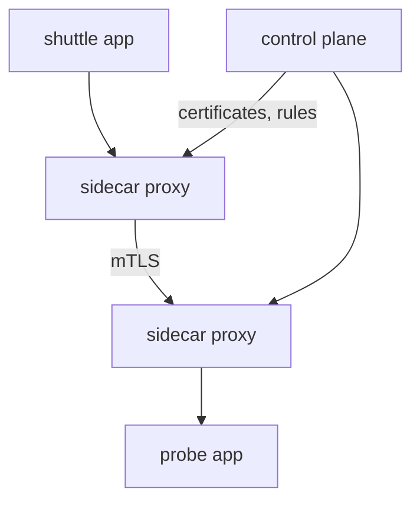

# Service Mesh And Transport Security

NetworkPolicy answers one question: may this source open a connection to that destination? It does not encrypt the traffic, it does not prove who the peer is, and it does not look inside the request. Other tools cover those needs. This part compares NetworkPolicy with a service mesh, and then explains Transport Layer Security (TLS), the protocol that provides encryption and identity, using a certificate you create yourself.

## What NetworkPolicy cannot do

A NetworkPolicy works at layers 3 and 4 of the network stack. It matches addresses, protocols and ports. It cannot match an HTTP path or method, it cannot tell two Pods apart that share a label, and it does not verify that the sender is the workload it claims to be. It also does not encrypt: a packet that an allowed Pod sends is readable by anything that can capture traffic on the path.

## What a service mesh adds

A service mesh is a layer that manages the communication between workloads. Istio and Linkerd are two examples. Most meshes place a sidecar proxy next to each application container, in the same Pod, and they send all traffic of the Pod through that proxy. Some newer designs run the proxy once per node. A control plane configures the proxies.

Because the proxies see every request, the mesh can offer features that the network layer cannot:

- **Mutual TLS (mTLS):** both sides of a connection present a certificate. The proxies encrypt the traffic and verify each other, without any change to the application code.
- **Authorization by identity:** a rule can say that only the workload with the identity of `shuttle` may call `probe`, and only with the `GET` method on a given path.
- **Traffic management:** retries, timeouts, traffic splitting by weight and fault injection.
- **Observability:** request counts, latency and traces for each call.

The two tools do not replace each other. A NetworkPolicy is enforced by the network plugin and works for every Pod, with or without a mesh. A mesh works only for traffic that goes through its proxies, so a policy is a useful second barrier.



The diagram shows two applications talking through their sidecar proxies, which encrypt the connection and verify each other, and a control plane that supplies the certificates and rules.

## TLS in one connection

TLS protects a connection between a client and a server. During the handshake the server sends a certificate. The certificate binds a public key to a name, such as `probe.starfleet.svc.cluster.local`, and a certificate authority (CA) signs it. A CA is an organisation or service that vouches for the binding. The client already holds the CA certificate, checks the signature, checks that the name in the certificate matches the name it wanted to reach, and checks that the certificate is not expired. If all checks pass, the two sides agree on session keys and encrypt the rest of the connection.

Encryption alone is not enough. Without the identity check, a client could encrypt its traffic to an attacker. The certificate check is what tells the client that the server is the one it asked for. In mutual TLS the server runs the same check on a client certificate.

## Build a certificate authority and a server certificate

The following exercise uses `openssl` on your own machine, in an empty directory. Nothing in the cluster is involved. First create a CA key and a self-signed CA certificate.

<!-- astrona:playground:renew -->

```sh
openssl req -x509 -newkey rsa:2048 -nodes -keyout ca.key -out ca.crt -days 30 -subj "/CN=starfleet-ca"
```

Create a key and a signing request for the `probe` name:

```sh
openssl req -newkey rsa:2048 -nodes -keyout probe.key -out probe.csr -subj "/CN=probe.starfleet.svc.cluster.local"
```

Modern clients check the Subject Alternative Name (SAN) field and ignore the common name. Save this as `san.cnf`:

```text
subjectAltName = DNS:probe.starfleet.svc.cluster.local
```

Sign the request with the CA:

```sh
openssl x509 -req -in probe.csr -CA ca.crt -CAkey ca.key -CAcreateserial -out probe.crt -days 30 -extfile san.cnf
```

Read what the certificate says, then verify it against the CA:

```sh
openssl x509 -in probe.crt -noout -subject -issuer -dates -ext subjectAltName
openssl verify -CAfile ca.crt -verify_hostname probe.starfleet.svc.cluster.local probe.crt
```

The first command should list the subject, the issuer `starfleet-ca`, the validity dates and the SAN name. The second should report `OK`. Now run the check with a different name:

```sh
openssl verify -CAfile ca.crt -verify_hostname scout.starfleet.svc.cluster.local probe.crt
```

This should report a hostname mismatch and fail. The signature is valid, but the certificate does not name `scout`. This is the identity check that protects a client from connecting to the wrong server.

## Certificates in Kubernetes

Kubernetes uses certificates in several places: between the control plane components, in the kubelet, and in an Ingress or Gateway that terminates TLS from a Secret of type `kubernetes.io/tls`. Meshes issue short-lived workload certificates automatically, so that no one distributes keys by hand. Expired certificates are a frequent cause of sudden connection failures, so the `-dates` output is worth reading first.

## What you now know

NetworkPolicy allows or denies connections by address and port. A service mesh adds encryption, workload identity and request-level rules through sidecar proxies. TLS encrypts a connection and uses a certificate, signed by a CA, to prove the name of the server, and mutual TLS proves the client as well.

## Common pitfalls

> [!WARNING]
> A NetworkPolicy neither encrypts traffic nor checks identity. A certificate that is valid for one name fails for another, even when the signature is correct. A self-signed certificate is trusted only by clients that were given the CA certificate. A mesh does not replace NetworkPolicy: it covers only the traffic that passes through its proxies.
