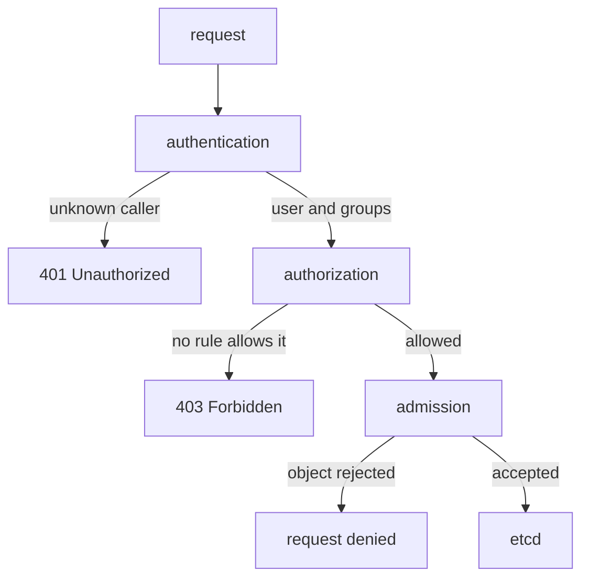

# API Request Checks And Workload Identity

A pipeline fails with an error, and the first question is which check refused it. Kubernetes does not answer one question for each request. It answers three, in a fixed order, and each one fails in a different way. If you know the order, you know which kind of fix a failure needs. This part follows one request through the three checks and then explains the identity that a running pod uses when it calls the API.

## One request, three checks

Every call from `kubectl`, a controller or a pod is an HTTPS request to the API server. The API server is the component that reads and writes the cluster state, which it keeps in etcd, the cluster database. It checks each request in this order:



The diagram shows three separate checks, each with its own way out, before an object reaches etcd.

Authentication answers "who is calling?". The API server reads a credential from the request, for example a client certificate or a bearer token, and produces a user name and a list of groups. If it cannot identify the caller, it returns `401 Unauthorized`. Authorization answers "may this caller do this?". On most clusters the Role-Based Access Control (RBAC) authorizer does this job. It looks at the user, the verb, the resource and the namespace. If no rule allows the request, the API server returns `403 Forbidden`.

Admission answers "is this object acceptable?". It runs only for requests that create, change or delete objects, and only after authorization has passed. Admission controllers can reject an object or change it. For example, the Pod Security admission controller rejects a pod that asks for more privilege than its namespace allows. Authorization never reads the content of the object. Admission does.

You can ask the API server who it thinks you are. Run this in the playground:

<!-- astrona:playground:renew -->

```sh
kubectl auth whoami
```

The command prints the user name and the groups that authentication produced for your credential. In the playground you are the cluster administrator, so the groups include `system:authenticated` and an administrator group. This is the identity that authorization then checks.

## Why the status code matters

The two codes name two different problems. A `401` means the API server does not know the caller, so you fix the credential: an expired token, a wrong certificate or a wrong kubeconfig file. A `403` means the API server knows the caller and the caller has no matching rule, so you fix the permissions. Changing a role will never fix a `401`, and replacing a token will never fix a `403`.

An admission rejection has a different shape again. The message names the admission controller or the policy that refused the object, and it describes the field that broke the rule. If a message talks about a pod field such as `privileged`, the request already passed authentication and authorization.

The order also tells you what each check can see. Authentication sees only the credential. Authorization sees the user name, the groups, the verb, the resource and the namespace. Admission sees the whole object. A rule that needs to look inside a pod spec, such as "no privileged containers", can therefore only live in admission and never in an RBAC role.

## What a ServiceAccount is

A person gets an identity from a certificate or from an identity provider. A pod needs an identity as well, because controllers and tools that run in the cluster call the API. A ServiceAccount is a namespaced Kubernetes object that gives a workload an identity. Its user name has a fixed form: `system:serviceaccount:<namespace>:<name>`. For the `shuttle` workload in `starfleet` the user name is `system:serviceaccount:starfleet:shuttle`.

Every namespace has a ServiceAccount called `default`. A pod that does not name a ServiceAccount runs as `default`. Each workload in the playground has its own ServiceAccount, so that permissions can be granted to one workload without changing the others. List them:

```sh
kubectl get serviceaccounts -n starfleet
```

The list shows `default`, the three workload accounts and `auditor`. A ServiceAccount carries no permissions when it is created. Authorization rules attach permissions to it later.

## How a pod receives a token

When a pod starts, the kubelet (the agent on each node) asks the API server for a token for the pod's ServiceAccount. The kubelet places the token in a file inside the container at `/var/run/secrets/kubernetes.io/serviceaccount/token`. The same directory holds the cluster certificate authority file and the namespace name. Client libraries inside the container read these files, so a program can call the API without extra setup.

This token is a signed JSON Web Token (JWT). Kubernetes calls it a bound token because it is tied to the pod: the token stops working when the pod is deleted. It also has an expiry time, one hour by default, and the kubelet refreshes the file before the token expires. Older Kubernetes versions created long-lived tokens that were stored in Secrets. Current versions do not create those Secrets automatically.

You can request a short-lived token for any ServiceAccount yourself:

```sh
kubectl create token shuttle -n starfleet
```

The command prints a JWT that the API server accepts as the identity `system:serviceaccount:starfleet:shuttle` until it expires. Anyone who holds the string can act as that account for that time, so treat it like a password and do not paste it into tickets or chat.

## Turning the token off

Most application pods never call the Kubernetes API, yet the token is mounted into every one of them by default. If an attacker gets code execution in such a pod, the token becomes a credential for the API. The ServiceAccount field `automountServiceAccountToken: false` stops the mount for every pod that uses the account. The same field in the pod spec stops it for one pod, and the pod setting wins when both are present.

Check what the `shuttle` pod has mounted:

```sh
kubectl exec -n starfleet deploy/shuttle -- ls /var/run/secrets/kubernetes.io/serviceaccount
```

The command lists the token, the certificate authority file and the namespace file. A pod with the automount setting turned off has no such directory, and the same command fails with a message that the directory does not exist.

Turning the token off does not remove the ServiceAccount identity. It only removes the credential from the container. A workload that needs the API must keep the token.

## What you know now

You know that the API server authenticates, authorizes and then admits each request, and that `401`, `403` and an admission message point to three different fixes. You know that a ServiceAccount is the identity of a pod, that its user name includes the namespace, and that the token inside the pod is a signed, expiring credential bound to that pod. What the identity may do is still open. That question belongs to roles and bindings.

## Common pitfalls

> [!WARNING]
> A `403 Forbidden` is not an authentication problem. Do not replace tokens to fix it. A ServiceAccount has no permissions until a binding gives it some, and the `default` ServiceAccount is shared by every pod that names no other account. Never grant rights to `default` to make one pod work.
