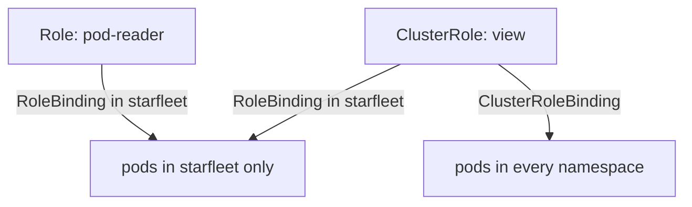

# RBAC Scope And Least Privilege

A new ServiceAccount can do nothing. To make a workload useful you must give it permissions, and the hard part is giving it enough without giving it too much. Role-Based Access Control (RBAC) is the authorizer that stores those permissions as Kubernetes objects. This part shows the four RBAC objects, how scope works, and how to apply least privilege: the rule that an identity gets only the access its job needs.

## Rules, roles and bindings

RBAC splits a permission into two objects. A role lists what may be done. A binding says who may do it. The two are separate so that one role can be given to many identities.

A rule inside a role has three main fields. `apiGroups` names the API group of the resource, and the core group is written as an empty string `""`. `resources` names the resource types, for example `pods` or `deployments`. `verbs` names the actions: `get`, `list`, `watch`, `create`, `update`, `patch` and `delete`. A request is allowed when one rule matches its API group, resource and verb. RBAC has only allow rules. Nothing is denied explicitly, and everything that no rule allows is forbidden.

Consider the `auditor` ServiceAccount in `starfleet`. It must read pods in that namespace and do nothing else. Save this as `role-pod-reader.yaml`:

<!-- astrona:playground:renew -->

```yaml
apiVersion: rbac.authorization.k8s.io/v1
kind: Role
metadata:
  name: pod-reader
  namespace: starfleet
rules:
  - apiGroups: [""]
    resources: ["pods"]
    verbs: ["get", "list", "watch"]
```

Apply it:

```sh
kubectl apply -f role-pod-reader.yaml
```

The role now exists, but nobody uses it. Check that `auditor` still has no right to list pods:

```sh
kubectl auth can-i list pods -n starfleet --as=system:serviceaccount:starfleet:auditor
```

The answer is `no`, because no binding connects the account to the role. Save this as `rolebinding-auditor-pod-reader.yaml`:

```yaml
apiVersion: rbac.authorization.k8s.io/v1
kind: RoleBinding
metadata:
  name: auditor-pod-reader
  namespace: starfleet
subjects:
  - kind: ServiceAccount
    name: auditor
    namespace: starfleet
roleRef:
  kind: Role
  name: pod-reader
  apiGroup: rbac.authorization.k8s.io
```

Apply it:

```sh
kubectl apply -f rolebinding-auditor-pod-reader.yaml
```

Then run the same `can-i` command again. The answer is now `yes`. The `subjects` list names who receives the rules. A subject is a user, a group or a ServiceAccount, and a ServiceAccount subject must carry its namespace. The `roleRef` names the role. It cannot be changed after the binding is created, so to point a binding at another role you delete it and create a new one.

## Scope: where a grant applies

Scope comes from the kind of object, not from the rules. A `Role` exists in one namespace, and its rules apply only there. A `ClusterRole` is not in a namespace. It can hold rules for cluster-wide resources such as nodes, and it can hold the same kind of rules as a `Role` for reuse in many namespaces.

The binding decides where the rules apply:



The diagram shows that a `RoleBinding` limits a grant to its own namespace, even when it points at a `ClusterRole`, while a `ClusterRoleBinding` grants the rules everywhere.

This is the most useful fact for exam questions. A team that needs the built-in `view` role in one namespace gets a `RoleBinding` in that namespace. The same role bound with a `ClusterRoleBinding` reads every namespace, including ones that do not exist yet. In the playground, the `ClusterRoleBinding` named `drifter-view` does exactly that for the `drifter` ServiceAccount in `outpost`. List the cluster-wide bindings to see it:

```sh
kubectl get clusterrolebindings drifter-view -o wide
```

The output shows the role `view` and the subject `drifter`. A client in `outpost` can therefore read pods in `starfleet`, which its team never needed.

## Least privilege in practice

Least privilege means three limits at once. Limit the verbs: a pipeline that updates Deployments needs `update` and `patch`, not `delete`. Limit the resources: name the exact resource types instead of using `*`. Limit the scope: use a `Role` and a `RoleBinding` in the namespace that the workload uses.

Built-in roles such as `edit` and `admin` are convenient but wide. The `edit` role can read every Secret in the namespace and create pods, and the ability to create a pod is already a way to read any Secret there, because the pod can mount it. `cluster-admin` allows every verb on every resource. Use these roles only when the job really needs them.

Two more details help in scenarios. A rule can name `resourceNames` to restrict a verb to one object, for example `get` on one ConfigMap. Also, `list` and `watch` on Secrets return the Secret contents, so a role that "only lists" Secrets still exposes the values.

## What you know now

You know that RBAC has two kinds of object, roles that hold rules and bindings that attach them to subjects, and that the binding kind and namespace decide the scope. You know how to limit verbs, resources and namespace for a workload. The next question is how to prove what an identity can do and how to find grants that are wider than they should be.

## Common pitfalls

> [!WARNING]
> A `ClusterRoleBinding` grants a role in every namespace, even if the role is meant for one team. A wildcard `*` in verbs or resources includes verbs and resources added in later versions. Binding a role to the `default` ServiceAccount gives the permission to every pod that uses it. A `RoleBinding` cannot grant access in a namespace other than its own.
