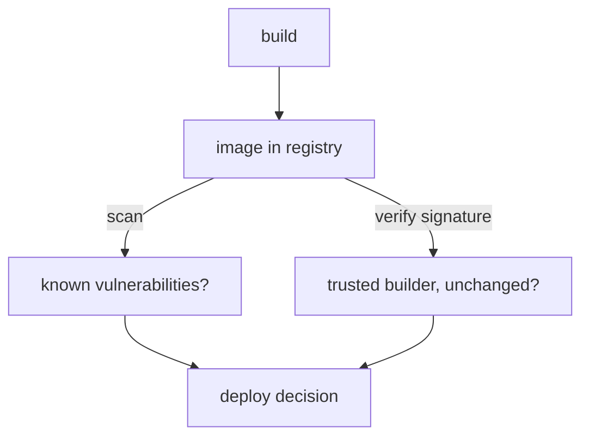

# Credentials And Image Supply Chains

Workloads need two things that attackers want: credentials such as API keys and passwords, and images, which are the code that runs. A leaked credential gives direct access to another system. A bad image runs attacker code inside your cluster with the permissions of your pod. This part shows how Kubernetes stores and delivers a credential, what protects it and what does not, and then separates the two checks that apply to images.

## What a Secret is

A Secret is a Kubernetes object that holds a small piece of sensitive data, such as a password, a token or a certificate. It exists so that you keep credentials out of images and pod specs. Like every object, the API server stores it in etcd. The values in the `data` field are encoded with base64, a text encoding that turns bytes into letters and digits.

Base64 is not encryption. Anyone who can read the Secret can decode it in one step. The playground has a Secret named `api-key` in `starfleet`. Read its raw value and decode it:

<!-- astrona:playground:renew -->

```sh
kubectl get secret api-key -n starfleet -o jsonpath='{.data.token}'
kubectl get secret api-key -n starfleet -o jsonpath='{.data.token}' | base64 -d
```

The first command prints an encoded string and the second prints the readable token. The encoding exists so that a Secret can hold binary data in a text format. It gives no protection.

## What really protects a Secret

Three controls protect a Secret, and base64 is none of them.

- **Access control.** RBAC decides who may `get`, `list` or `watch` Secrets. A `list` request returns every value, so `list` is as sensitive as `get`. The right to create pods in a namespace also exposes its Secrets, because a pod can mount any Secret of its namespace.
- **Encryption at rest.** By default the API server writes Secrets to etcd in clear text. An administrator can turn on encryption at rest with an `EncryptionConfiguration` file for the API server. Then a stolen etcd backup or disk does not reveal the values.
- **Careful delivery.** How the Secret reaches the application decides who else can see it.

## Environment variable or volume

A pod can receive a Secret in two ways. With an environment variable, a `secretKeyRef` copies the value into the process environment at start. With a volume, the kubelet writes each key as a file in a memory-backed filesystem (tmpfs), so the value does not touch the node disk.

Save this as `pod-secret-demo.yaml`. The pod receives the same Secret in both ways:

```yaml
apiVersion: v1
kind: Pod
metadata:
  name: secret-demo
  namespace: starfleet
spec:
  containers:
    - name: shell
      image: busybox:1.37
      command: ["sleep", "3600"]
      env:
        - name: API_KEY
          valueFrom:
            secretKeyRef:
              name: api-key
              key: token
      volumeMounts:
        - name: api-key
          mountPath: /etc/api-key
          readOnly: true
  volumes:
    - name: api-key
      secret:
        secretName: api-key
```

Apply it:

```sh
kubectl apply -f pod-secret-demo.yaml
```

Then check both paths once the pod runs:

```sh
kubectl exec -n starfleet secret-demo -- printenv API_KEY
kubectl exec -n starfleet secret-demo -- cat /etc/api-key/token
```

Both commands print the same value. The difference is in what else can reach it. An environment variable lives in the process environment, so it is inherited by every child process, and it often appears in crash reports, debug output and tools that print the environment. It never changes while the pod runs. A mounted file is readable only by processes that can open the path, can be given restrictive file modes, and the kubelet updates it when the Secret changes. For these reasons a volume is the safer default. A key mounted with `subPath` is the exception, because the kubelet does not update it.

## Two checks for an image

An image is the code your container runs, so its origin and its contents both matter. Two different checks answer two different questions.

A vulnerability scan answers "does this image contain software with known flaws?". A scanner unpacks the image layers, lists the installed packages and libraries, and compares them with a database of published vulnerabilities. Its result is a list of findings with severities. It reads the contents of the image and says nothing about who built it.

A signature check answers "was this exact image produced by someone I trust, and has it been changed since?". The builder signs the image digest with a private key and publishes the signature. A verifier checks it with the matching public key. Signing proves identity and integrity, and it says nothing about whether the software inside is free of flaws. A signed image can still be vulnerable, and a clean image can still be unsigned.



The diagram shows that scanning and signature verification inspect the same image for different reasons, and both feed the decision to deploy.

## Digests and tags

A tag such as `6.15.0` is a label that a registry can move to a different image. A digest is a `sha256` hash of the image content, and it always names exactly one image. The container runtime records the digest of the image it pulled. Read it for the `scout` pod:

```sh
kubectl get pod -n starfleet -l app=scout -o jsonpath='{.items[0].status.containerStatuses[0].imageID}'
```

The result ends with `@sha256:` and the digest. Signing tools sign this digest, so a deployment that references the image by digest cannot be silently pointed at different content.

## What you know now

You know that base64 only encodes, that RBAC, encryption at rest and the delivery method protect a Secret, and that a mounted volume exposes a value to fewer paths than an environment variable. You know that a scan checks contents against known flaws, that a signature checks origin and integrity, and that a digest pins exact content. Which of these checks the cluster enforces at admission is still open.

## Common pitfalls

> [!WARNING]
> Committing a Secret manifest to a repository publishes the value, because base64 is reversible. A role that allows `list` on Secrets exposes every value. Do not treat a passing vulnerability scan as proof of origin, and do not treat a valid signature as proof that the software has no known flaws.
