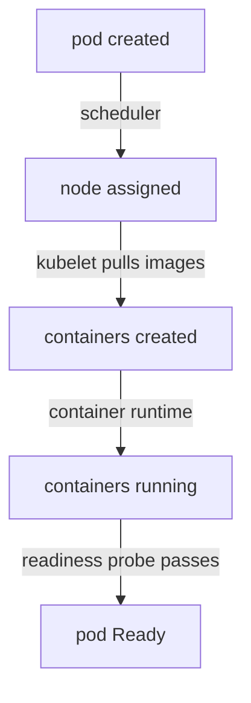

# Placement And Dependency Evidence

You apply a Deployment and, a minute later, its pod is still `Pending`. Nothing has crashed and nothing has been pulled, because the pod has not even reached a node. This part explains the pod lifecycle, the fields that record it, and the two most common reasons the scheduler cannot place a pod: a node selector and a resource request.

## The pod lifecycle and its evidence

A pod moves through a fixed set of stages. The API server stores the pod object. The scheduler (`kube-scheduler`, the control plane component that picks a node for each new pod) chooses a node and writes it into the pod. The kubelet (the agent on each node) then pulls the images, creates the containers and starts them. Finally the kubelet runs the probes that decide whether the pod is Ready.



The diagram shows the order of the stages and that a different component owns each step, so a failure at one stage points at one component.

Three kinds of evidence record these stages. The **phase** (`.status.phase`) is a short summary: `Pending` (accepted but not all containers are running), `Running`, `Succeeded`, `Failed` or `Unknown`. The **conditions** (`.status.conditions`) are finer: `PodScheduled`, `Initialized`, `ContainersReady` and `Ready`, each `True` or `False` with a reason. The **events** are short records that components such as the scheduler and the kubelet write about the pod. Events are the most useful of the three, because they carry the reason in words.

## Reading a pod that stays Pending

Run the playground's first command. The `-o wide` flag adds the node name, which is empty for a pod that was never scheduled:

<!-- astrona:playground:renew -->

```sh
kubectl get pods -n starfleet -o wide
```

`lander` and `hauler` should show `Pending` and `<none>` in the `NODE` column. Phase `Pending` also covers pods that are scheduled and still pulling images, so the empty node column is what tells you the scheduler has not placed the pod. Ask for the reason with `describe`, and read the `Conditions` and `Events` at the bottom:

```sh
kubectl describe pod -n starfleet -l app=lander
```

The condition `PodScheduled` should be `False`. The events should contain a `FailedScheduling` event from `default-scheduler`. Its message starts with "0/1 nodes are available" and then counts the nodes it rejected for each reason. For `lander`, the reason is that the node did not match the pod's node selector. The scheduler does not guess: it tests every node against every rule and reports the rule that removed each node.

## Node selectors, affinity and taints

A **node selector** (`spec.nodeSelector`) is a map of labels. The scheduler only considers nodes that carry every label in the map. The `lander` Deployment asks for `disktype: quantum`, and no node has that label. You can see the labels the node does have:

```sh
kubectl get nodes --show-labels
```

There are two fixes: remove or correct the selector in the pod template, or label a node. Changing the pod template is the safer fix when the selector is a mistake. Labelling a node is the right fix when the node really has that property and the label was forgotten.

Two other rules produce a similar message. **Node affinity** (`spec.affinity.nodeAffinity`) is a richer form of the selector, with operators such as `In` and `NotIn` and a "preferred" form that only ranks nodes. A **taint** is a key, a value and an effect set on a node, such as `NoSchedule`. A pod can only use a tainted node if it has a matching **toleration**. In the event text, a taint appears as "had untolerated taint". A single-node `kind` cluster removes the control-plane taint from its only node so that ordinary pods can run on it. The `Pending` pods in the playground are therefore caused by the selector and the request, not by a taint.

## Resource requests

A **resource request** (`resources.requests`) is the amount of CPU and memory the scheduler reserves for a container on a node. The scheduler adds up the requests of every pod already on a node and compares the sum with the node's **allocatable** capacity, which is the node's total minus what the system reserves. A pod fits only when its requests fit in what is left. The scheduler looks at requests, not at what the pods actually use.

The `hauler` Deployment requests 64 CPUs. Compare that with the node:

```sh
kubectl describe node | grep -A 8 "Allocatable"
```

The `Allocatable` block shows the CPU and memory the node offers to pods. The `hauler` pod's events should say `Insufficient cpu`. Memory works the same way, with the message `Insufficient memory`. A request is a promise to the scheduler, so a request that is too large makes the pod unschedulable even if the application would use almost nothing.

## Events outside one pod

`kubectl describe` shows only the events of one pod. Events are also objects in the namespace, so you can list them all, newest last, and see which component reported what:

```sh
kubectl get events -n starfleet --sort-by=.lastTimestamp
```

Each row has a type (`Normal` or `Warning`), a reason, the object it is about and a message. Events expire after about an hour by default, so collect them early. The events of one object also stop growing when the problem repeats, because the API server merges identical events into one row with a count.

## Fixing the Pending pods without guessing

The evidence names the rule, so each fix is one change. Remove the impossible selector from `lander`:

```sh
kubectl patch deployment lander -n starfleet --type=json -p='[{"op":"remove","path":"/spec/template/spec/nodeSelector"}]'
```

Lower the request of `hauler` to a value that fits:

```sh
kubectl set resources deployment hauler -n starfleet --requests=cpu=10m
```

Both commands change the pod template, so the Deployment controller creates a new ReplicaSet and a new pod. Check the pods again with `kubectl get pods -n starfleet -o wide`. The new `lander` and `hauler` pods should now have a node. The old `Pending` pods are removed once the new pods are Ready. If a pod gets a node and then shows a different state, such as `ImagePullBackOff`, you have moved to the next stage, and the next stage has its own evidence.

Pods can also stay `Pending` because they wait on something they depend on. A pod that mounts a PersistentVolumeClaim stays `Pending` until the claim is bound. In that case the `FailedScheduling` event mentions "unbound immediate PersistentVolumeClaims". The method is the same: the event names the missing dependency.

## What you know now

You can map a stuck pod to a lifecycle stage and a responsible component, read a `FailedScheduling` event, and distinguish a selector or taint problem from a resource request problem. The open question is what happens after the scheduler succeeds: a pod with a node can still fail while its image is pulled or its container starts.

## Common pitfalls

> [!WARNING]
> Phase `Pending` does not always mean "not scheduled". Check the `NODE` column and the `PodScheduled` condition. A `Pending` pod with a node is waiting on the kubelet, for example for an image pull. Also remember that requests, not real usage, decide placement: a pod that uses little can still be unschedulable. And do not label a node to make a wrong selector match unless the node really has that property.
