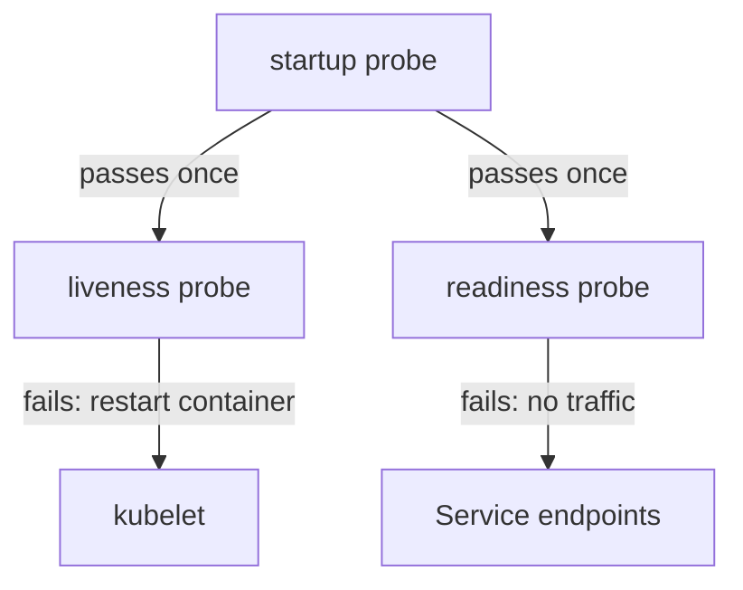

# Probes And Safe Corrective Changes

A container can be running and still be useless: the process is up but cannot serve requests yet, or it is stuck and will never recover. Kubernetes cannot see inside the application, so it asks the application through probes. This part explains what each probe does, what a failing probe changes, and how to correct a Deployment so that you can prove the change worked and undo it if it did not.

## Three probes, three different decisions

A **probe** is a check that the kubelet runs against a container: an HTTP request (`httpGet`), a TCP connection (`tcpSocket`), a command run inside the container (`exec`) or a gRPC call. The check passes or fails. What happens after a failure depends on which probe it is.

- The **readiness probe** decides whether the pod receives traffic. When it fails, the pod's `Ready` condition becomes `False`, and the Service stops sending requests to the pod. The container is not restarted.
- The **liveness probe** decides whether the container must be restarted. When it fails the number of times set by `failureThreshold`, the kubelet kills the container, and the restart policy starts a new one. Traffic is not the concern here. Recovery is.
- The **startup probe** protects slow applications. While it has not passed yet, the kubelet does not run the liveness and readiness probes. When it passes once, the other two start.



The diagram shows that the startup probe gates the other two, and that a liveness failure acts on the container while a readiness failure acts on the Service endpoints.

The timing fields are the same for all three: `initialDelaySeconds` (wait before the first check), `periodSeconds` (time between checks), `timeoutSeconds`, `successThreshold` and `failureThreshold`. A liveness probe with a short period and a threshold of 1 turns one slow response into a restart.

## Probe handlers

The handler decides what "pass" means. An `httpGet` probe passes on any status code from 200 to 399, so a `404` or a `500` fails it. A `tcpSocket` probe passes when the kubelet can open a connection to the port, which proves a listener exists and nothing about the application behind it. An `exec` probe passes when the command exits with code 0. A `grpc` probe passes when the standard health service answers `SERVING`.

Use a readiness probe that checks what the pod needs in order to serve, and keep a liveness probe cheap and independent of other services. A liveness probe that calls a database turns a database outage into a restart of every pod.

## A pod that runs but is not Ready

The `warden` pod has a readiness probe on the path `/ready-check`. List the pods:

<!-- astrona:playground:renew -->

```sh
kubectl get pods -n starfleet -l app=warden
```

The `STATUS` column should say `Running`, and the `READY` column `0/1`. The container started, so the image, the command and the memory limit are fine. The pod is not Ready, so the probe fails. Describe the pod to see why:

```sh
kubectl describe pod -n starfleet -l app=warden
```

In the events, the kubelet reports `Unhealthy` with a message that says `Readiness probe failed` and gives the reason, for an HTTP probe the status code, such as `HTTP probe failed with statuscode: 404`. In the conditions, `ContainersReady` and `Ready` are `False` while `PodScheduled` and `Initialized` are `True`. That pattern is the signature of a readiness failure.

The application serves `/readyz` and not `/ready-check`. The probe is wrong, not the application. A wrong probe path or port is a very common cause of a pod that never becomes Ready, so check the probe against the application before you look at the application.

## Change one thing, then prove it

A safe change has four steps. First collect the evidence, which you did above. Second, name one cause. Third, make one change that matches the cause. Fourth, verify with the same evidence that failed before. Changing several fields at once makes it impossible to know which one worked, and it can hide a second fault.

Correct the probe path with a JSON patch that replaces only that field:

```sh
kubectl patch deployment warden -n starfleet --type=json -p='[{"op":"replace","path":"/spec/template/spec/containers/0/readinessProbe/httpGet/path","value":"/readyz"}]'
```

A change to the pod template makes the Deployment controller create a new ReplicaSet. This is a **rolling update**: it starts a new pod, waits for it to be Ready, and then removes the old one. With the default settings, a Deployment never removes a working pod before its replacement is Ready, so a bad change usually leaves the old pods serving. Watch the result:

```sh
kubectl rollout status deployment/warden -n starfleet
```

The command waits until the new pod is Ready and then reports that the rollout completed. If the new pod never becomes Ready, the command keeps waiting and finally reports that the deadline was exceeded. The Deployment's `progressDeadlineSeconds` (600 seconds by default) sets that limit, and the Deployment gets a condition `Progressing` with the reason `ProgressDeadlineExceeded`.

## History and rollback

Each pod template gets its own ReplicaSet, and the Deployment remembers the previous ones. The revisions are the history of the Deployment:

```sh
kubectl rollout history deployment/warden -n starfleet
```

The list should show a revision for the original template and one for your fix. If a change makes things worse, `kubectl rollout undo deployment/warden -n starfleet` returns to the previous revision. A rollback only restores the pod template. It does not restore a ConfigMap, a Secret or a Service that you changed, so write down what you changed outside the Deployment.

Keep the edits narrow. `kubectl set image`, `kubectl set resources` and a JSON patch change one field. `kubectl edit` is useful for reading and small changes, but it makes it easy to change a second field by accident. For a change that must be repeated, change the YAML file that the team keeps and apply it again, so the live object and the file do not drift apart.

## Deciding which probe to fix

When a pod restarts, look at the liveness probe and the events before the application. When a pod runs but gets no traffic, look at the readiness probe and the Service endpoints. When an application needs a long time to start and keeps being restarted, a startup probe or a larger `initialDelaySeconds` fixes it, and removing the liveness probe does not. Removing a probe makes the symptom disappear and also removes the protection that the probe gives.

## What you know now

You can tell what each probe controls, recognize a readiness failure from `Running` with `0/1` and an `Unhealthy` event, make one targeted change, verify it with a rollout and use history to roll back. The pod now runs and is Ready. The open question is why a Ready pod may still not be reachable through a Service, which depends on the cluster around the pod.

## Common pitfalls

> [!WARNING]
> A failing readiness probe never restarts a container, and a failing liveness probe does. Do not remove a probe to make an error disappear: fix what it checks. Do not change several fields in one step. A rollback restores only the pod template, not the objects around it.
