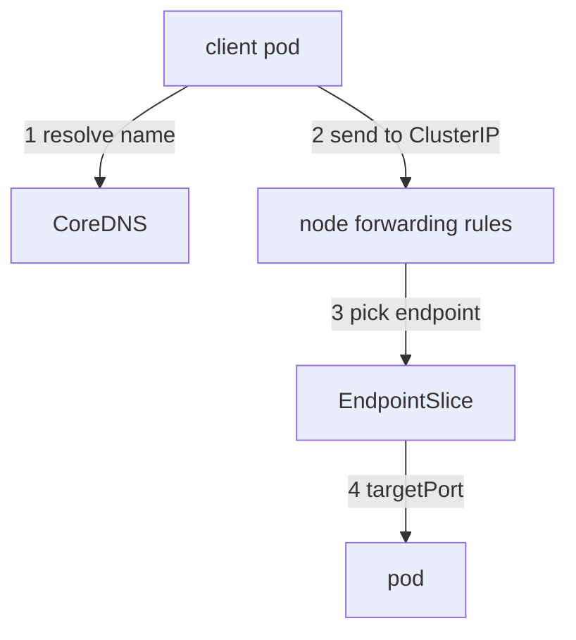

# Tracing A Service Request

The `shuttle` client sends a request to `http://probe` and does not get an answer. The `probe` pod is Running. Between the client and the pod sit a Service, a list of endpoints and a port mapping, and each of them can break the path while every pod looks healthy. This part follows one request through these hops and shows which command proves each one.

## What a Service does

A **Service** is a stable virtual IP address and port (the ClusterIP) in front of a changing set of pods. The Service has a **selector**, a set of labels. The control plane watches the pods and writes the addresses of every pod that matches the selector and is Ready into **EndpointSlice** objects. The proxy on each node (`kube-proxy`, or the network plugin when it replaces it) reads the EndpointSlices and sets up forwarding rules, so a packet sent to the ClusterIP is redirected to one of the pod addresses.



The diagram shows the four hops of one request, and the EndpointSlice is the only place where the Service and the pods meet.

A Service has two port fields. `port` is the port on the ClusterIP that clients use. `targetPort` is the port on the pod that receives the traffic, and it can be a number or the name of a container port. The EndpointSlice records the resolved `targetPort`.

## Start with the symptom from the client

Send one request from the client and look at how it ends. The exit code of `curl` names the hop: `6` is a name that does not resolve, `7` is a refused connection, `28` is a timeout, and an HTTP status means the request reached an application:

<!-- astrona:playground:renew -->

```sh
kubectl exec deploy/shuttle -n starfleet -- sh -c "curl -s -o /dev/null -m 5 -w 'http=%{http_code}\n' http://probe/get; echo curl_exit=\$?"
```

The `probe` Service exists, so the name should resolve. The request should not end with an HTTP 200. Because the name resolved, you can skip DNS and test the next hop: does the Service have endpoints?

## A selector that matches nothing

List the EndpointSlices of the Service. Kubernetes labels every EndpointSlice with the name of its Service:

```sh
kubectl get endpointslices -n starfleet -l kubernetes.io/service-name=probe
```

The `ENDPOINTS` column should show `<unset>`. An empty slice means the selector matches no Ready pod. Compare the selector with the labels of the pods:

```sh
kubectl get service probe -n starfleet -o jsonpath='{.spec.selector}{"\n"}'
kubectl get pods -n starfleet --show-labels
```

The selector asks for `app=probes`, and the pod has `app=probe`. One letter differs, so no pod matches. The Service has a ClusterIP and a DNS name, so it looks fine in `kubectl get svc`. A Service with no endpoints rejects connections, which `curl` reports as exit code `7` on most clusters. The fix belongs in the Service, because the pod is correct. Correct the selector:

```sh
kubectl patch service probe -n starfleet --type=merge -p '{"spec":{"selector":{"app":"probe"}}}'
```

The EndpointSlice is updated within a moment, and the request from `shuttle` should now end with HTTP 200.

## A target port that nothing listens on

The `relay` Service has an endpoint, and its request still fails. Show the port that the EndpointSlice holds and the port of the container:

```sh
kubectl get endpointslices -n starfleet -l kubernetes.io/service-name=relay -o jsonpath='{.items[*].ports[*].port}{"\n"}'
```

The slice should show port `8081`, and the container listens on `8080`. The request reaches the pod's IP address, finds no process on port 8081 and is refused. This failure looks different from the previous one: the Service has endpoints, the pod is Ready, and the connection is refused at the pod. The fix is `targetPort`. Using the container port name (`http`) instead of a number keeps the Service correct when the number changes.

A third case is a Service whose pods exist but are not Ready. The control plane lists such pods in the EndpointSlice with the condition `ready: false`, and the forwarding rules do not use them. The `gate` Service is in this state: its only pod fails its readiness probe. Clients get the same refused connection as for an empty Service. Check the `READY` column of the pod before you change the Service. A Service that depends on a Ready pod protects clients from a pod that cannot serve, so the Service is behaving correctly.

To see the readiness of the endpoints of `gate`, print the slice and read the `conditions` field of its endpoint:

```sh
kubectl get endpointslices -n starfleet -l kubernetes.io/service-name=gate -o yaml
```

The endpoint should list the pod address with `ready: false`. The same view for a healthy Service shows `ready: true`. `kubectl describe service gate -n starfleet` shows the same addresses in its `Endpoints` line only for Ready pods, which is why a not-Ready pod can look like a missing endpoint there.

## A short checklist for one Service

Work through the hops in order and stop at the first one that fails:

1. Does the name resolve to the ClusterIP of the Service in the right namespace?
2. Does the Service have the `port` the client uses?
3. Does the EndpointSlice have at least one endpoint? If not, compare selector and labels, and check that the pods are Ready.
4. Does the `targetPort` in the EndpointSlice match the port the container listens on?
5. Does the process listen on all addresses, and not only on `127.0.0.1`? An application that listens only on localhost cannot be reached through the pod IP.

A Service of type `NodePort` or `LoadBalancer` adds more hops (the node port, the external load balancer), and the checklist for them starts after hop 4. The internal path is the same, so prove it first with a request from inside the cluster.

## What you know now

You can follow a request from the client to the pod, tell an empty Service from a wrong port and from a pod that is not Ready, and prove each case with an EndpointSlice. The open question is what happens at the first hop, the name lookup, and how to look at the network from inside a pod that has no tools.

## Common pitfalls

> [!WARNING]
> A Service with no endpoints still has a ClusterIP and a DNS name, so `kubectl get svc` looks healthy. Always read the EndpointSlice. Do not change the pod labels to match a wrong selector unless the selector is the correct side, because other objects can depend on those labels. A Ready pod and an endpoint do not prove that the `targetPort` is right.
