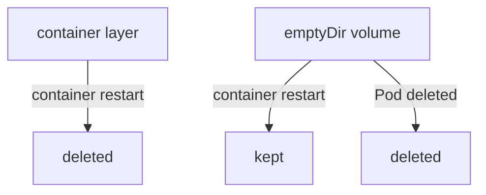

# Container Filesystem And Ephemeral Volumes

A container image is a stack of read-only layers. When the container runtime starts a container, it adds one thin writable layer on top and gives the process a filesystem made of all the layers together. Every file the process creates goes into that writable layer. The kubelet, the agent that runs on each node and manages its Pods, can delete a container and start a new one at any time. The new container gets a fresh writable layer, and the old files are gone. This part shows exactly which files survive that replacement and which do not, because the answer decides where an application may keep its data.

## The writable container layer

The writable layer belongs to one container instance, not to the Pod and not to the image. A container restart is a new container instance, so it starts with an empty writable layer. A container restarts when its process exits and the Pod's `restartPolicy` allows it, when a liveness probe fails, or when the node runs out of memory and the kernel stops the process. The Pod, with its name, its IP address and its volumes, stays the same during all of these events.

Kubernetes does not copy the writable layer anywhere before it deletes the container. There is also no size guarantee: the layer uses the node's disk, and a process that writes a lot into it can push the node into disk pressure. For these two reasons, treat the container filesystem as scratch space for files that the application can create again.

The `scout` Pod in your playground shows this. Its container loops and exits with an error when it finds `/tmp/crash`. Write a file to the container layer and a file to the `emptyDir` volume at `/scratch`, then create the crash file:

<!-- astrona:playground:renew -->

```sh
kubectl -n starfleet exec deploy/scout -- sh -c 'echo layer > /tmp/layer-note; echo volume > /scratch/volume-note'
kubectl -n starfleet exec deploy/scout -- touch /tmp/crash
```

The container exits within a second. The kubelet starts a new container in the same Pod. Check the restart count and the two files:

```sh
kubectl -n starfleet get pods -l app=scout
kubectl -n starfleet exec deploy/scout -- ls /tmp /scratch
```

The `RESTARTS` column now shows 1. The listing shows `volume-note` in `/scratch` and no `layer-note` and no `crash` in `/tmp`. The file in the container layer is gone, and the file in the volume is still there. This is the whole difference between container-local storage and a volume.

## emptyDir: storage for the life of the Pod

An `emptyDir` volume is a directory that the kubelet creates on the node when it assigns the Pod to that node. It starts empty and every container of the Pod can mount it. It survives container restarts, because the directory belongs to the Pod. It is deleted for good when the Pod is removed from the node, for any reason: `kubectl delete pod`, an eviction, a node drain or a Deployment rollout that replaces the Pod.

By default, the directory is on the node's disk. With `medium: Memory`, the kubelet mounts a `tmpfs` (a filesystem that lives in RAM) instead. Memory-backed files count against the container's memory limit, and they disappear when the node restarts. The `sizeLimit` field sets a maximum size, and the kubelet evicts the Pod when the volume grows beyond it.

Typical uses are scratch space for a sort or a build, a cache that can be rebuilt, and a directory that two containers of one Pod share. Two containers in the same Pod share files by mounting the same `emptyDir`, because they have separate container layers but can mount the same volume.



The diagram shows that a container restart deletes only the container layer, and that the `emptyDir` is deleted when the Pod is deleted.

Now delete the whole Pod and look at `/scratch` in the replacement:

```sh
kubectl -n starfleet delete pod -l app=scout
kubectl -n starfleet rollout status deployment/scout
kubectl -n starfleet exec deploy/scout -- ls /scratch
```

The Deployment's ReplicaSet creates a new Pod. The new Pod gets a new, empty `emptyDir`, so the listing shows no `volume-note`. Data that must survive a Pod deletion needs a volume that is not tied to the Pod.

## configMap and secret volumes: configuration as files

A `configMap` volume turns the keys of a ConfigMap into files, one file per key, and the value becomes the file content. A `secret` volume does the same for a Secret. The kubelet writes the files and keeps them current: when someone updates the ConfigMap, the kubelet updates the files in a running Pod after a short delay, without a restart. The update does not reach a container that mounts the volume with `subPath`, and it does not reach environment variables.

The kubelet writes Secret volumes to a `tmpfs`, so the values do not reach the node's disk. Both volume types are read-only for the application in practice, and a Secret volume is mounted with mode `0644` unless `defaultMode` says otherwise. These volumes are not application storage. They carry small pieces of configuration and credentials from the API into the Pod.

Read the files that the `scout` Pod received:

```sh
kubectl -n starfleet exec deploy/scout -- sh -c 'ls /etc/scout /etc/scout-secret; cat /etc/scout/mode'
```

The first `ls` shows the ConfigMap keys `interval` and `mode`, and the second shows the Secret key `token`. The `cat` prints `patrol`.

## hostPath: a directory of the node

A `hostPath` volume mounts a file or directory of the node's own filesystem into the Pod. The data survives Pod deletion because it lives on the node. It stays on that one node, so a Pod that the scheduler places on another node sees different files. A `hostPath` volume also gives the container access to the node's filesystem, which is a security risk, and the `baseline` and `restricted` Pod Security Standards forbid it.

Use `hostPath` for node-level agents that must read node files, such as a log collector. Do not use it for application data. On a single-node test cluster such as `kind`, the default storage also keeps its data in a directory on the node, so data looks persistent in a playground even when the same design would lose it on a cluster with several nodes.

Compare the four lifetimes in one place:

| Where the file is | Survives a container restart | Survives Pod deletion | Shared between nodes |
| --- | --- | --- | --- |
| Container layer | No | No | No |
| `emptyDir` | Yes | No | No |
| `hostPath` | Yes | Yes, only on the same node | No |
| PersistentVolume through a claim | Yes | Yes | Depends on the storage backend |

You now know which files survive which event. The open question is how to get a volume whose life does not depend on any single Pod, and that is the job of the PersistentVolume.

## Common pitfalls

> [!WARNING]
> - Do not store data you cannot recreate in the container layer or in an `emptyDir`. A Deployment rollout, an eviction or a node drain deletes the Pod and its `emptyDir` with it.
> - A `configMap` or `secret` volume mounted with `subPath` never receives updates. Mount the whole directory when the application must see changes.
> - `medium: Memory` counts against the container memory limit. A large file in a memory-backed volume can get the container killed.
> - A Pod that restarts keeps its `emptyDir`. A Pod that is replaced does not. Check which of the two happened before you decide that data was lost.
