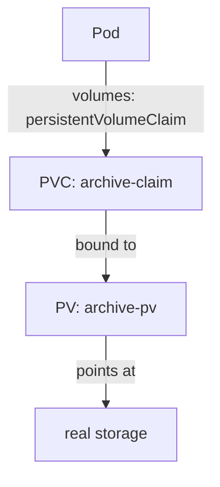

# PersistentVolumes And Claims

An application that must keep its data needs storage that exists on its own, outside any one Pod. Kubernetes separates two jobs to make this work. One side describes real storage that exists in the cluster. The other side describes what an application asks for. The control plane then matches the two. This part creates both sides by hand and shows how the match happens, because the same objects appear in every storage failure you will diagnose.

## The two objects

A PersistentVolume (PV) is a cluster-level object that describes one piece of real storage: how big it is, which access modes it allows, where the data lives and what happens to it when it is no longer needed. A PV has no namespace. An administrator creates it by hand, or a provisioner creates it automatically.

A PersistentVolumeClaim (PVC) is a namespaced object that asks for storage: a minimum size, the access modes the Pod needs and, optionally, a StorageClass. A Pod never names a PV. A Pod names a PVC in its `volumes` list, and the PVC stands between the Pod and the storage. This separation lets a developer ask for "1 GiB that one node can write" without knowing where the storage is.



The diagram shows that the Pod reaches the real storage only through the claim and the volume that the claim is bound to.

## Create a volume by hand

The playground cluster has one node, so a `hostPath` volume is enough to see the objects work. Save this as `pv-archive.yaml`:

<!-- astrona:playground:renew -->

```yaml
apiVersion: v1
kind: PersistentVolume
metadata:
  name: archive-pv
spec:
  capacity:
    storage: 1Gi
  accessModes:
    - ReadWriteOnce
  persistentVolumeReclaimPolicy: Retain
  storageClassName: manual
  hostPath:
    path: /mnt/starfleet-archive
    type: DirectoryOrCreate
```

Apply it:

```sh
kubectl apply -f pv-archive.yaml
```

Then check the result:

```sh
kubectl get pv archive-pv
```

The `STATUS` column shows `Available`. An available PV is free: no claim uses it. The `capacity` field is the size that the PV offers, `accessModes` lists how nodes may mount it, and `storageClassName: manual` is only a label here. No provisioner and no StorageClass object named `manual` is needed, because nothing creates this volume. The label only lets a claim ask for exactly this kind of volume.

## Claim the volume and watch the binding

Save this as `pvc-archive-claim.yaml`:

```yaml
apiVersion: v1
kind: PersistentVolumeClaim
metadata:
  name: archive-claim
  namespace: starfleet
spec:
  accessModes:
    - ReadWriteOnce
  storageClassName: manual
  resources:
    requests:
      storage: 500Mi
```

Apply it and look at both objects:

```sh
kubectl apply -f pvc-archive-claim.yaml
kubectl -n starfleet get pvc archive-claim
kubectl get pv archive-pv
```

Both now show `Bound`. The claim asked for 500Mi, and the PV shows 1Gi. A claim binds to a PV that is at least as big as the request, so the claim receives the whole 1Gi volume. The size that the claim shows in its `CAPACITY` column is the PV's size, not the requested size.

The PV controller, a loop that runs inside `kube-controller-manager`, does the binding. For each unbound claim it looks for an available PV that matches on four things: the `storageClassName` string must be equal, the PV must offer every access mode that the claim lists, the PV capacity must be at least the request, and the `volumeMode` (filesystem or block) must be equal. A claim can add a `selector` with labels to narrow the choice, or a `volumeName` to name one PV. When the controller finds a match, it writes the claim's name into the PV's `claimRef` field and writes the PV's name into the claim's `volumeName`. A PV and a PVC bind one to one: a bound PV serves exactly one claim, even if the PV is larger than the claim needs.

If no PV matches, the claim stays `Pending`. The controller checks again whenever a PV or a claim changes, so creating a matching PV later binds the waiting claim. `kubectl describe pvc` shows the reason in its events.

## Use the claim in a Pod and keep the data

A Pod mounts the claim by name. Save this as `pod-archivist.yaml`:

```yaml
apiVersion: v1
kind: Pod
metadata:
  name: archivist
  namespace: starfleet
spec:
  containers:
    - name: archivist
      image: busybox:1.37
      command: ["sh", "-c", "echo logbook > /archive/entry; sleep 3600"]
      volumeMounts:
        - name: archive
          mountPath: /archive
  volumes:
    - name: archive
      persistentVolumeClaim:
        claimName: archive-claim
```

Apply it, delete the Pod, apply it again and read the file:

```sh
kubectl apply -f pod-archivist.yaml
kubectl -n starfleet delete pod archivist
kubectl apply -f pod-archivist.yaml
kubectl -n starfleet exec archivist -- cat /archive/entry
```

The file `entry` exists in the second Pod. The first Pod is gone, but the claim and the volume are not, so the data stayed. A Pod that is deleted while a claim exists does not delete the claim.

The claim also protects itself. While a Pod uses a claim, the claim carries the finalizer `kubernetes.io/pvc-protection` (a marker that makes the API server delay deletion). A `kubectl delete pvc` on a claim that a Pod still uses leaves the claim in `Terminating` until the Pod is gone. The PV has the matching finalizer `kubernetes.io/pv-protection`, which stops the deletion of a PV that is still bound to a claim.

## What the phases tell you

A PV moves through the phases `Available`, `Bound`, `Released` and `Failed`. A claim has the phases `Pending`, `Bound` and `Lost`. `Released` means that the claim was deleted but the volume was not yet cleaned up for reuse. `Lost` means that the claim's PV no longer exists. A claim that stays `Pending` usually has one of three causes: no PV matches, the StorageClass does not exist, or the binding mode waits for a Pod. You now know how a hand-made volume binds. The next question is who creates the volume when nobody wants to create it by hand.

## Common pitfalls

> [!WARNING]
> - A PVC and a PV bind one to one. A 500Mi claim that binds a 1Gi PV occupies the whole PV, and no other claim can use the remainder.
> - `storageClassName` must be the same string on both sides. An empty string (`""`) is different from a missing field: it asks for a PV that has no class.
> - A claim is namespaced and a PV is not. A Pod can only use a claim from its own namespace.
> - Deleting the Pod does not delete the claim, and deleting the claim does not always delete the data. What happens to the volume depends on its reclaim policy.
