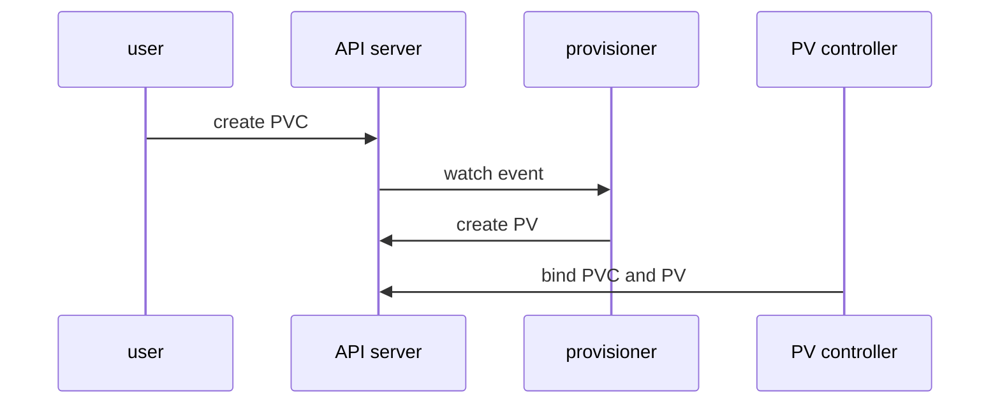

# StorageClasses, Provisioning And CSI

Creating a PersistentVolume by hand for every claim does not scale. A platform team would need to create a volume in the storage system, copy its details into a PV and wait for each developer request. Dynamic provisioning removes that step. When a claim names a StorageClass, a provisioner creates the volume and the PV on demand. This part follows one claim from creation to a bound volume, names the component that does each step and explains the standard interface that storage vendors implement.

## What a StorageClass defines

A StorageClass is a cluster-level object that describes one kind of storage a cluster can create. It does not hold data. It holds a recipe:

- `provisioner` names the component that creates volumes of this class, for example `rancher.io/local-path` or the name of a CSI driver such as `ebs.csi.aws.com`.
- `parameters` is a map of settings that only the provisioner understands, such as disk type or file system.
- `reclaimPolicy` is copied to every PV that the class creates. The default is `Delete`.
- `volumeBindingMode` is either `Immediate` or `WaitForFirstConsumer`.
- `allowVolumeExpansion` says whether a claim of this class may be resized.

One StorageClass can carry the annotation `storageclass.kubernetes.io/is-default-class: "true"`. A claim that leaves out `storageClassName` receives the default class. A `kind` cluster ships a default class named `standard`. Look at it:

<!-- astrona:playground:renew -->

```sh
kubectl get storageclass
kubectl get storageclass standard -o yaml
```

The first command marks `standard` as `(default)`. The second shows its provisioner, its `reclaimPolicy` and its `volumeBindingMode`. A `kind` node image installs a local path provisioner for this class, and the class normally waits for the first consumer. Read the fields in your own output rather than assuming them, because a different node image can change them.

## The dynamic provisioning flow

A claim that names a StorageClass starts a chain of steps. Each step has one component that does the work:



The diagram shows that the user only creates the claim, and that the provisioner and the PV controller react to it.

The API server stores the claim. A provisioner, which is a controller that watches PersistentVolumeClaims for its own StorageClass, sees the claim and creates the real storage. It then creates a PV object that describes it, with the claim's name already in `claimRef`. The PV controller binds the two. The provisioner is not part of Kubernetes itself. The class names it, and the cluster runs it, usually as a Deployment or a DaemonSet.

## Immediate and WaitForFirstConsumer

With `volumeBindingMode: Immediate`, the provisioner creates the volume as soon as the claim exists. The storage may then be placed on a node or in a zone where the Pod cannot run. With `WaitForFirstConsumer`, the claim stays `Pending` until a Pod that uses it exists. The scheduler then picks a node, tells the provisioner the node, and the provisioner creates the volume where the Pod will run. This mode is the safe choice for storage that is tied to a node or a zone.

Save this as `pvc-scout-data.yaml`:

```yaml
apiVersion: v1
kind: PersistentVolumeClaim
metadata:
  name: scout-data
  namespace: starfleet
spec:
  accessModes:
    - ReadWriteOnce
  resources:
    requests:
      storage: 1Gi
```

Apply it and read the status:

```sh
kubectl apply -f pvc-scout-data.yaml
kubectl -n starfleet get pvc scout-data
kubectl -n starfleet describe pvc scout-data
```

The claim names no class, so it receives `standard`. If the class waits for the first consumer, the claim shows `Pending` and the events say that it is waiting for a consumer. That `Pending` is normal. It is not an error. Now start a consumer. Save this as `pod-scout-writer.yaml`:

```yaml
apiVersion: v1
kind: Pod
metadata:
  name: scout-writer
  namespace: starfleet
spec:
  containers:
    - name: writer
      image: busybox:1.37
      command: ["sh", "-c", "echo report > /data/report; sleep 3600"]
      volumeMounts:
        - name: data
          mountPath: /data
  volumes:
    - name: data
      persistentVolumeClaim:
        claimName: scout-data
```

Apply it and list the objects:

```sh
kubectl apply -f pod-scout-writer.yaml
kubectl -n starfleet get pvc,pod
kubectl get pv
```

The claim moves to `Bound` and the Pod to `Running`. A new PV exists with a generated name that starts with `pvc-`, and its `CLAIM` column shows `starfleet/scout-data`. Nobody wrote that PV. The provisioner created it.

## The Container Storage Interface

The Container Storage Interface (CSI) is a standard set of calls between a container orchestrator and a storage system. Before CSI, storage code for each vendor lived inside the Kubernetes source. With CSI, a vendor ships a driver that runs in the cluster and Kubernetes talks to it through the standard calls.

A CSI driver has two halves. The controller plugin runs as a Deployment and handles volume-level work that needs no node: create a volume, delete it, attach it to a node, take a snapshot, expand it. The node plugin runs as a DaemonSet on every node and does the node-level work: format the device, mount it into a directory and mount it into the Pod's container. The kubelet calls the node plugin when it prepares a Pod's volume.

Small sidecar containers from the Kubernetes project connect the driver to the API. The `external-provisioner` watches claims and calls the driver's create call. The `external-attacher` handles attaching. The `external-resizer` handles expansion and the `external-snapshotter` handles snapshots. The `node-driver-registrar` tells the kubelet which socket the node plugin listens on. A `CSIDriver` object records driver settings, such as whether the driver needs an attach step. You can list the installed drivers:

```sh
kubectl get csidrivers
```

A `kind` cluster may show none, because its default class uses a simple provisioner and not a CSI driver. A cloud cluster lists the vendor's drivers here.

## StatefulSets and volumeClaimTemplates

A Deployment's replicas all share the same Pod template, so they would share one claim. A StatefulSet, the workload for applications where each replica needs its own identity and data, solves this with `volumeClaimTemplates`. For each replica, the StatefulSet controller creates a claim named `<template>-<statefulset>-<ordinal>`, for example `data-probe-0` and `data-probe-1`. When a replica's Pod is deleted and re-created, the new Pod with the same ordinal mounts the same claim again. Scaling the StatefulSet down does not delete the claims, so the data stays for a later scale-up.

A claim now creates its own volume, and a driver behind a standard interface does the storage work. What remains open is how the volume behaves: which nodes may mount it, what happens to it when the claim is deleted, and whether it can grow.

## Common pitfalls

> [!WARNING]
> - A claim in `Pending` is not always an error. With `WaitForFirstConsumer`, it waits for a Pod. Read the events with `kubectl describe pvc` before you change anything.
> - A claim that names a StorageClass that does not exist stays `Pending` forever. `storageClassName` cannot be changed on an existing claim, so delete and re-create the claim.
> - The default class applies only when `storageClassName` is missing. `storageClassName: ""` asks for no class and no dynamic provisioning.
> - A StatefulSet's `volumeClaimTemplates` cannot be edited on an existing StatefulSet, and deleting the StatefulSet does not delete its claims.
