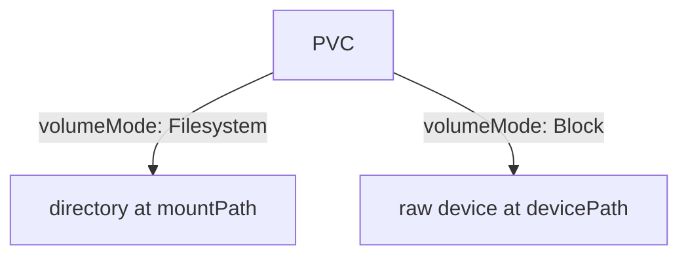

# Access Modes And Data Presentation

Two volumes can offer the same size and still behave very differently once Pods use them. One allows several nodes to write at the same time. Another allows one node. A third allows exactly one Pod in the whole cluster. This part explains the four access modes, what enforces each one, and how the volume mode decides whether a Pod sees a directory or a raw device. These settings are the first thing to check when a second Pod refuses to start.

## What an access mode is

An access mode is a statement about how nodes may mount a volume. A PersistentVolume lists the modes its storage backend supports. A PersistentVolumeClaim lists the modes the application needs, and the claim only binds to a volume that offers every one of them. The modes are:

| Mode | Short form | Meaning |
| --- | --- | --- |
| `ReadWriteOnce` | RWO | Read and write mount by a single node |
| `ReadOnlyMany` | ROX | Read-only mount by many nodes |
| `ReadWriteMany` | RWX | Read and write mount by many nodes |
| `ReadWriteOncePod` | RWOP | Read and write mount by a single Pod in the whole cluster |

A mode is not a permission system. It limits where a volume can be attached or mounted. It does not decide which user inside the container may write a file. A claim with `ReadOnlyMany` does not make the files read-only for a Pod that mounts it unless the Pod also asks for `readOnly: true`.

## ReadWriteOnce limits nodes, not Pods

The name says "once", but the limit counts nodes. With `ReadWriteOnce`, one node can mount the volume read-write, and every Pod that runs on that node can use it at the same time. A second Pod that the scheduler places on another node cannot mount the volume while the first node holds it. That Pod waits, and the events show an attach or mount error.

On the one-node playground cluster, the node limit never triggers. Two Pods that use the same `ReadWriteOnce` claim both start. Try it with the claim `shuttle-logs` that the `shuttle` Deployment already uses. Save this as `pod-drifter-reader.yaml`:

<!-- astrona:playground:renew -->

```yaml
apiVersion: v1
kind: Pod
metadata:
  name: drifter-reader
  namespace: starfleet
spec:
  containers:
    - name: reader
      image: busybox:1.37
      command: ["sh", "-c", "sleep 3600"]
      volumeMounts:
        - name: logs
          mountPath: /logs
  volumes:
    - name: logs
      persistentVolumeClaim:
        claimName: shuttle-logs
```

Apply it and read the file that `shuttle` wrote:

```sh
kubectl apply -f pod-drifter-reader.yaml
kubectl -n starfleet get pods -o wide
kubectl -n starfleet exec drifter-reader -- cat /logs/marker.txt
```

Both Pods run on the same node, and the file `marker.txt` is readable from the second Pod. On a cluster with several nodes, the second Pod could land on another node and stay in `ContainerCreating`. The result depends on where the scheduler places the Pod, which is why a single-node test does not prove that an application works with `ReadWriteOnce` at scale.

## ReadWriteMany and ReadOnlyMany need a shared backend

Block devices such as a cloud disk attach to one node at a time. They support `ReadWriteOnce` and nothing wider. A network file system such as NFS, or a distributed file system, lets many nodes mount the same files. Those backends support `ReadWriteMany` and `ReadOnlyMany`. The StorageClass or the CSI driver documentation states which modes it supports. If a claim asks for a mode that the provisioner cannot offer, the claim stays `Pending` or the provisioning fails, and the events of the claim say so.

## ReadWriteOncePod limits the whole cluster

`ReadWriteOncePod` closes the gap in `ReadWriteOnce`. Only one Pod in the whole cluster can use the claim at a time. The scheduler checks it: a second Pod that uses the claim stays `Pending` with a scheduling message that names the claim. Use it for an application that corrupts data when two instances write at once, such as a database that must run as one instance, and where an accidental second Pod must be refused.

`ReadWriteOncePod` is supported only for volumes that a CSI driver provides. The default storage of a `kind` cluster is not a CSI volume. A claim with this mode may therefore stay `Pending`, or it may bind without being enforced, depending on the provisioner version. Create one and read what your cluster does. Save this as `pvc-single-pod.yaml`:

```yaml
apiVersion: v1
kind: PersistentVolumeClaim
metadata:
  name: single-pod
  namespace: starfleet
spec:
  accessModes:
    - ReadWriteOncePod
  storageClassName: standard
  resources:
    requests:
      storage: 1Gi
```

Apply it and read the events:

```sh
kubectl apply -f pvc-single-pod.yaml
kubectl -n starfleet describe pvc single-pod
```

Read the events instead of assuming the result. The point of the exercise is that the mode is a request that the storage backend must be able to meet, and that the cluster tells you through events whether it can.

## Filesystem and block volume modes

The `volumeMode` field says how the volume is presented. The default is `Filesystem`. The kubelet formats the device with a file system if it has none, and mounts it at the `mountPath` of the container. The application sees a directory.

With `volumeMode: Block`, the Pod receives the raw device, with no file system. The container does not use `volumeMounts`. It uses `volumeDevices` with a `devicePath`, and the device appears as a file such as `/dev/xvda`. Databases and other software that manage their own on-disk format use block volumes to skip the file system layer. The claim and the volume must agree on the mode, and the driver must support it. A claim with `Block` does not bind to a volume with `Filesystem`.



The diagram shows that the claim's volume mode decides whether the container sees a directory or a raw device.

You now know how many nodes or Pods may use a volume and how the Pod sees it. The next question is what happens to the data when the claim is deleted.

## Common pitfalls

> [!WARNING]
> - `ReadWriteOnce` allows many Pods on one node. Use `ReadWriteOncePod` when only one Pod may ever write.
> - A single-node test cluster hides node-level limits. A second Pod that starts on a test cluster can fail on a cluster with several nodes.
> - Asking for `ReadWriteMany` on a block-device StorageClass leaves the claim `Pending`. Check which modes the driver supports.
> - `volumeMode: Block` gives a raw device with no file system. The application must format and manage it, and the Pod uses `volumeDevices`, not `volumeMounts`.
