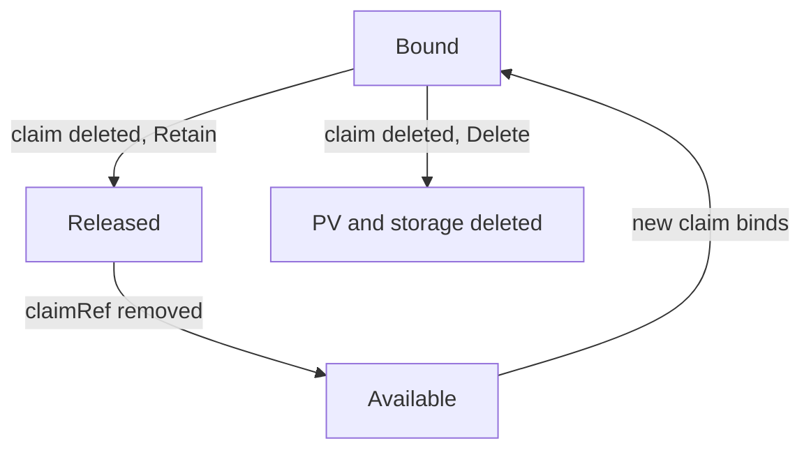

# Reclaim Policies And Recovery

A developer deletes a claim to clean up a namespace. The question that matters is whether the data on the volume goes with it. Kubernetes answers this with the reclaim policy of the PersistentVolume, which the control plane reads at the moment the claim is deleted. This part shows both policies in action, explains the `Released` phase and walks through the recovery of a volume that a claim left behind.

## Two policies

The reclaim policy is the field `persistentVolumeReclaimPolicy` in the PV `spec`. It has these values:

- `Delete`: when the claim is deleted, the PV object is deleted and the provisioner removes the storage behind it. The data is gone.
- `Retain`: when the claim is deleted, the PV object stays, in the phase `Released`, and the storage and its data stay too. An administrator decides what happens next.

A third value, `Recycle`, wiped the volume and made it available again. It is deprecated, and only `nfs` and `hostPath` volumes supported it. Use dynamic provisioning instead.

The policy of a dynamically created volume comes from the StorageClass field `reclaimPolicy`, which defaults to `Delete`. A volume that an administrator creates by hand gets the value written in its own YAML, and the default for a PV without the field is `Retain`. The two defaults differ, so check the volume and do not guess.

Which component acts? The PV controller in `kube-controller-manager` notices that the claim is gone, reads the policy and either releases the PV or asks the provisioner to delete the storage. The data is not touched by the Pod or by the kubelet.

## Read the policy of a volume

Find the volume behind the claim `shuttle-logs` and read its policy:

<!-- astrona:playground:renew -->

```sh
kubectl -n starfleet get pvc shuttle-logs -o jsonpath='{.spec.volumeName}{"\n"}'
kubectl get pv
```

The `RECLAIM POLICY` column of the PV shows `Delete` if the class has the default policy. If the class differs on your cluster, you read a different value, and the rest of this part follows the value that you read. The PV also names its claim in the `CLAIM` column as `starfleet/shuttle-logs`.

## Change the policy of an existing volume

The policy of a PV can change while the volume exists. The policy is part of the PV, not of the claim, so you patch the PV. Substitute the PV name from the previous step for `<PV_NAME>`:

```sh
kubectl patch pv <PV_NAME> -p '{"spec":{"persistentVolumeReclaimPolicy":"Retain"}}'
kubectl get pv <PV_NAME>
```

The column now reads `Retain`. This is the standard protection step before any work that deletes claims. Without it, deleting the claim would remove the storage, and the `Delete` policy leaves no way back.

## Delete the claim and read the Released phase

Delete the workload first, because a claim that a Pod uses cannot finish deleting. Then delete the claim and read the volume:

```sh
kubectl -n starfleet delete deployment shuttle
kubectl -n starfleet delete pvc shuttle-logs
kubectl get pv <PV_NAME>
```

The PV still exists, and its status is `Released`. The data stays on the node. The PV still holds a `claimRef` that points at the deleted claim `starfleet/shuttle-logs`, including that claim's unique ID. The PV controller reads this reference and refuses to bind the PV to a new claim, even a new claim with the same name, because the data belongs to the previous claimant and a new claimant must not read it by accident.



The diagram shows that the policy decides the path after claim deletion, and that a retained volume becomes available again only after an administrator removes the claim reference.

## Reuse a retained volume

An administrator has three choices for a `Released` volume. Delete the PV object and the storage by hand. Copy the data out and then delete it. Or reuse the volume with its data. To reuse it, remove the stale reference:

```sh
kubectl patch pv <PV_NAME> --type=json -p '[{"op":"remove","path":"/spec/claimRef"}]'
kubectl get pv <PV_NAME>
```

The PV returns to `Available`. A new claim can now bind to it. A claim that must get exactly this volume names it in `spec.volumeName`. Save this as `pvc-shuttle-logs-restored.yaml`, replacing `<PV_NAME>`:

```yaml
apiVersion: v1
kind: PersistentVolumeClaim
metadata:
  name: shuttle-logs-restored
  namespace: starfleet
spec:
  accessModes:
    - ReadWriteOnce
  storageClassName: standard
  volumeName: <PV_NAME>
  resources:
    requests:
      storage: 1Gi
```

Apply it and read the status:

```sh
kubectl apply -f pvc-shuttle-logs-restored.yaml
kubectl -n starfleet get pvc shuttle-logs-restored
```

The claim binds to the retained volume. A Pod that mounts it finds the old file `/logs/marker.txt` if the node-level data was kept. The data of a dynamically provisioned local volume lives in a directory on the node. That directory is not removed under `Retain`.

## What reclaiming does not protect

A reclaim policy covers one event: deletion of the claim. It does not protect against deletion of the PV object itself, against a namespace deletion that removes the claim and then follows the policy, or against a storage-side failure. Deleting a whole namespace deletes its claims, and `Delete` volumes go with them. A `Retain` volume stays but becomes `Released`, and the namespace's name no longer helps you find it, so record which PV belongs to which application before an incident. You now know how to keep a volume after its claim is gone. The last topic is how a volume grows and how data survives problems that a reclaim policy cannot cover.

## Common pitfalls

> [!WARNING]
> - The reclaim policy is read when the claim is deleted. Change it before the deletion, because after a `Delete` volume is removed there is nothing left to patch.
> - A `Released` volume does not bind to a new claim until `spec.claimRef` is removed. A new claim with the same name stays `Pending`.
> - `Retain` leaves the data and the storage cost. Someone must delete orphaned volumes later.
> - The default policy differs: StorageClass-created volumes get `Delete`, and a hand-made PV without the field gets `Retain`.
