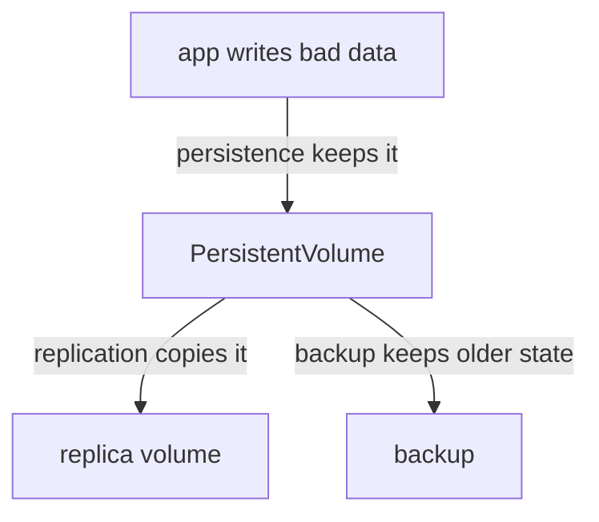

# Expansion, Snapshots And Data Protection

Data grows, and sometimes it is damaged. A volume that was big enough on the first day fills up, and a bad deployment or a deleted table can destroy data that the storage system still stores correctly. This part covers the two features Kubernetes offers for these cases, claim expansion and volume snapshots, and then separates three properties that teams often treat as one: persistence, replication and backup.

## Expanding a claim

To make a volume larger, edit the claim and raise `spec.resources.requests.storage`. The API server accepts the change only when the claim's StorageClass sets `allowVolumeExpansion: true`. Without it, the API server rejects the edit and the claim keeps its size. Kubernetes cannot shrink a claim: the new value must be larger than the current size.

The work is split between components. The `external-resizer` sidecar of a CSI driver (or the expansion controller for older volume types) sees the new request and calls the storage backend to grow the volume. The kubelet then grows the file system on the node. The claim shows the condition `FileSystemResizePending` while it waits for this second step, and some drivers need a Pod restart to finish it. Only file systems that the node can grow online, such as ext4 and XFS, are supported. A volume with `volumeMode: Block` grows the device and leaves the application to grow its own format.

Read what your class allows:

<!-- astrona:playground:renew -->

```sh
kubectl get storageclass standard -o jsonpath='{.allowVolumeExpansion}{"\n"}'
```

An empty answer means the field is not set, which is the same as `false`. The value on your cluster, not an assumption, decides the next steps. Save this as `pvc-expand-demo.yaml`:

```yaml
apiVersion: v1
kind: PersistentVolumeClaim
metadata:
  name: expand-demo
  namespace: outpost
spec:
  accessModes:
    - ReadWriteOnce
  storageClassName: standard
  resources:
    requests:
      storage: 1Gi
```

Apply it, then ask for 2Gi:

```sh
kubectl apply -f pvc-expand-demo.yaml
kubectl -n outpost patch pvc expand-demo -p '{"spec":{"resources":{"requests":{"storage":"2Gi"}}}}'
```

If the class does not allow expansion, the API server answers with an error and the claim stays at 1Gi. If the class allows it, the patch is accepted, and the claim and its volume change over the next seconds or minutes. Run `kubectl -n outpost describe pvc expand-demo` and read the conditions and events. Read what you actually see, because the behavior differs between provisioners.

## Volume snapshots

A volume snapshot is a point-in-time copy of a volume's data, made by the storage backend. Kubernetes models it with three API objects, which are custom resources installed by the external snapshot controller and its CRDs, not part of the core API:

- `VolumeSnapshotClass` names the CSI driver that takes snapshots and a deletion policy.
- `VolumeSnapshot` is the namespaced request: "snapshot this claim".
- `VolumeSnapshotContent` is the cluster-level record of the actual snapshot. It plays the same role for snapshots that a PersistentVolume plays for claims.

The `external-snapshotter` sidecar calls the driver. To restore, a new claim names the snapshot in `spec.dataSource`, and the provisioner creates a new volume filled from the snapshot. Snapshots work only with CSI drivers that implement them. Check whether the cluster has the objects:

```sh
kubectl api-resources --api-group=snapshot.storage.k8s.io
```

A plain `kind` cluster normally does not install the snapshot CRDs, so the list can be empty. A cloud cluster with a CSI driver installs them with the driver.

## Persistence, replication and backup

Three words describe three different protections. Mixing them is how data gets lost.

Persistence means that data survives a restart or deletion of the Pod. A PersistentVolume gives persistence. Replication means that the storage system keeps more than one live copy, so a failed disk or node does not make the data unavailable. A replicated disk or a distributed file system gives it. A backup is a separate, older copy of the data, stored somewhere that the original failure cannot reach, and used to recover to an earlier point in time.



The diagram shows that persistence and replication keep and copy whatever the application wrote, bad data included, while a backup keeps an older state.

Take two examples. A claim is deleted by mistake and the policy is `Delete`: persistence did not help, replication copied the deletion, and only a backup restores the data. A node disk fails and the volume had a replica: replication saves the data, and a backup is not needed for that case. A snapshot on the same storage system is a quick recovery point, but it is not a full backup, because a failure of the storage system can destroy both the volume and its snapshots. A backup tool for Kubernetes copies the objects and the volume data to an external location, and it must be tested by restoring.

## Choosing for an application

Match the protection to the failure that you must survive. A cache needs none of the three: an `emptyDir` is enough. A database that restarts needs persistence. A database that must stay available through a node loss needs replication, either in the storage or in the database itself. A database whose data matters needs regular backups on top, with a tested restore. The sequence also shows why the reclaim policy and expansion are not data protection: they manage the volume and not the history of the data.

Volume expansion, snapshots and backups each answer a different question: how to get more space, how to get back to a recent state quickly and how to survive the loss of the storage itself. The decision that remains is which of these an application needs, and that decision depends on the failure the business cannot accept, not on the features the cluster offers.

## Common pitfalls

> [!WARNING]
> - A claim can only grow, never shrink, and only when the StorageClass sets `allowVolumeExpansion: true`. Check before you promise a resize.
> - Replication copies mistakes. A dropped table is dropped on every replica.
> - A snapshot kept on the same storage system is not a backup. Keep a copy somewhere the same failure cannot reach.
> - Snapshots need the snapshot CRDs, the snapshot controller and a CSI driver that supports them. A cluster without them has no `VolumeSnapshot` kind.
